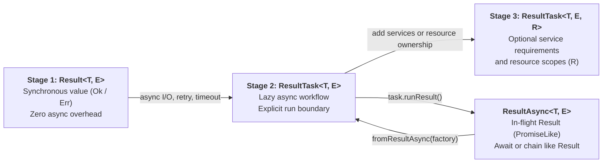

# Resultar

**Typed error handling and resilient workflows for TypeScript — from a single `Result<T, E>` to lazy, dependency-injected `ResultTask<T, E, R>`.**

[](https://nodejs.org)
[](packages/resultar/package.json)
[](packages/check/README.md)
[](LICENSE)

[Core Package](packages/resultar/README.md) · [Gradual Adoption Guide](docs/gradual-adoption.md) · [Full Reference (`DOCUMENTATION.md`)](DOCUMENTATION.md) · [`resultar-check` Compiler CLI/LSP](packages/check/README.md) · [Benchmarks](benchmarks/README.md) · [AI / Agent Skill (`llms.txt`)](llms.txt)

---

## Why Resultar in 30 Seconds

In standard TypeScript, `throw` and rejected promises are invisible in function signatures. Callers cannot tell what can fail—or whether every failure mode was handled—without reading the implementation of every transitive call.

```ts
// ❌ Standard TypeScript: the signature promises a number, but silently throws at runtime
const parsePort = (input: string): number => {
  const port = Number(input)
  if (!Number.isInteger(port) || port <= 0) {
    throw new Error(`Invalid port ${input}`) // invisible to the type checker!
  }
  return port
}
```

Resultar moves expected failures into the return type, composes them linearly with `yield*`, and enforces exhaustive handling at your application boundary:

```ts
import { createTaggedError, ok, Result, ResultTask } from 'resultar'

// 1. Define real Error subclasses with typed $prop interpolation, causes, and redaction
class InvalidEmailError extends createTaggedError({
  name: 'InvalidEmailError',
  message: 'Invalid email $email',
}) {}

class AccountExistsError extends createTaggedError({
  name: 'AccountExistsError',
  message: 'Account $email already exists',
}) {}

class DatabaseError extends createTaggedError({
  name: 'DatabaseError',
  message: 'Database $operation failed',
}) {}

// 2. Write pure domain functions with explicit Result<T, E> contracts
const normalizeEmail = (raw: string): Result<string, InvalidEmailError> => {
  const email = raw.trim().toLowerCase()
  return email.includes('@') ? ok(email) : InvalidEmailError.err({ email })
}

// 3. Compose sync + async steps linearly — TypeScript infers the exact error union
const registerAccount = (input: string) =>
  ResultTask.gen(function* () {
    const email = yield* normalizeEmail(input)

    if (email === 'taken@example.com') {
      return yield* AccountExistsError.err({ email })
    }

    return yield* ResultTask.tryPromise({
      try: () => db.accounts.insert({ email }),
      catch: (cause) => new DatabaseError({ cause, operation: 'insert-account' }),
    })
  })
// Inferred: ResultTask<Account, InvalidEmailError | AccountExistsError | DatabaseError>

// 4. Handle every failure exhaustively at the boundary (compile error if a tag is missed!)
const result = await registerAccount(req.body.email).runResult()
const response = result.matchTags(
  (account) => ({ status: 201, body: account }),
  {
    InvalidEmailError: (err) => ({ status: 400, body: { code: err._tag, message: err.message } }),
    AccountExistsError: (err) => ({ status: 409, body: { code: err._tag, message: err.message } }),
    DatabaseError: (err) => ({ status: 503, body: { code: err._tag, message: err.message } }),
  },
)
```

---

## Install

```sh
pnpm add resultar
# Optional native TypeScript-Go compiler + Resultar linter & LSP:
pnpm add -D resultar-check
```

Also published on JSR as [`@inaiat/resultar`](https://jsr.io/@inaiat/resultar).

---

## Philosophy: Why Resultar?

Resultar began as a fork of `neverthrow` and evolved to occupy the practical middle ground between lightweight `Result` boxes and full functional runtimes like `Effect`.

### 1. The Sweet Spot Between `neverthrow` and `Effect`

| Capability | `neverthrow` | `Resultar` | `Effect` |
| --- | --- | --- | --- |
| **Entry cost** | 1 function (`Result<T, E>`) | **1 function (`Result<T, E>`)** | Full `Effect<A, E, R>` ecosystem |
| **Async execution boundary** | `await ResultAsync<T, E>` | **Explicit Task runners (`task.runResult()` returns `ResultAsync<T, E>`)** | `Effect.runPromise` / runtime |
| **Tagged `Error` classes & secret redaction** | Manual | **Built-in (`createTaggedError`, `redact`)** | Built-in (`Data.TaggedError`, `Redacted`) |
| **Retries, timeouts, races & virtual clock** | Manual | **Built-in (`Retry.policy`, `timeout`, `Clock.virtual`)** | Built-in (`Schedule`, `TestClock`) |
| **Typed DI (`R`), LIFO resource scopes & fibers** | No | **Opt-in via `ResultTask<T, E, R>` & `resultar-di`** | Always present (`Effect<A, E, R>`, `Layer`, `Scope`) |
| **Native compiler enforcement (`noDiscard`)** | ESLint plugin | **Native TypeScript-Go CLI & LSP (`resultar-check`)** | Language service plugin |

### 2. Adopt Gradually: Three Primitives, One Mental Model

Start with synchronous `Result` values and add `ResultTask` for asynchronous workflows. Executing a task with `task.runResult()` returns `ResultAsync<T, E>` — an in-flight `Result` (`PromiseLike<Result<T, E>>`) that can be awaited directly or transformed and folded with the same methods as `Result`:



- **Stage 1 — `Result<T, E>`**: Use in pure parsing, validation, and domain functions.
- **Stage 2 — `ResultTask<T, E>`**: Use for new async operations, retries, and timeouts. Build work lazily and execute it with `runResult`, `runExit`, `runPromise`, or `runFork`.
- **Stage 3 — `ResultTask<T, E, R>`**: Add typed service dependencies or owned resources when needed. Providing requirements leaves a Task that still needs an explicit runner.
- **In-flight Result — `ResultAsync<T, E>`**: Returned by `task.runResult()` / `ResultTask.runResult(task)` (and in-flight constructors `okAsync`, `errAsync`, `unitAsync`, `fromPromise`, `fromSafePromise`, `tryResultAsync`). Await it directly for `Result<T, E>` or chain `.map()`, `.andThen()`, `.catchTag()`, `.match()`, `.unwrapOr()`, and `.unwrapOrThrow()`. Eager `ResultAsync` orchestration helpers remain deprecated for existing API compatibility; see the [migration table](docs/migrations/v4.md).

Prefer `task.runResult()`, `task.runPromise()`, `task.runExit()`, and `task.runFork()` in new code.
The static forms, such as `ResultTask.runResult(task, options)`, remain equivalent and supported.
Both forms enforce service requirements and accept the same execution options. `runResult` returns a `ResultAsync`
that resolves typed errors as `Err` (and rejects defects, interruption, and composite causes); `runPromise` resolves
the value or rejects, `runExit` preserves every outcome as a value, and `runFork` starts a root fiber
immediately. Each call starts a new execution. See the [runner reference](packages/resultar/README.md#lazy-workflows-with-resulttask).

```ts
import { createTaggedError, ok, Result, ResultTask, Retry } from 'resultar'

class InvalidIdError extends createTaggedError({ name: 'InvalidIdError', message: 'Invalid id $id' }) {}
class UserNotFoundError extends createTaggedError({ name: 'UserNotFoundError', message: 'User $id not found' }) {}

// Stage 1: Synchronous Result<T, E>
const parseUserId = (raw: string): Result<string, InvalidIdError> =>
  raw.startsWith('usr_') ? ok(raw) : InvalidIdError.err({ id: raw })

// Stage 2: Requirement-free ResultTask<T, E>, executed at an explicit boundary
const fetchProfile = (id: string) =>
  ResultTask.tryPromise({
    try: (signal) => fetch(`https://api.example.com/users/${id}`, { signal }).then((r) => r.json()),
    catch: (cause) => new UserNotFoundError({ id, cause }),
  }).retry(Retry.policy({ times: 2, delayMs: 50 }))

// Stage 3: Add typed service requirements and tagged recovery to the same Task model
const AuditLog = ResultTask.service<{ record(id: string): ResultTask<void> }>()('AuditLog')

const loadAndAuditUser = ResultTask.fn(
  function* (rawId: string) {
    const id = yield* parseUserId(rawId)      // Stage 1 yielded directly
    const user = yield* fetchProfile(id)      // Stage 2 yielded directly
    const audit = yield* AuditLog             // Stage 3 adds R = Service<'AuditLog', ...>
    yield* audit.record(id)
    return user
  },
  ResultTask.catchTag('UserNotFoundError', (err) => ok({ id: err.id, guest: true })),
)
// Inferred: (rawId: string) => ResultTask<User | Guest, InvalidIdError, Service<'AuditLog', ...>>
```

### 3. Sync-First, Pay-As-You-Go Execution Engine

Resultar's runtime is engineered so that gradual adoption is also **pay-as-you-go at runtime**:

- **Zero-microtask synchronous fast path**: `Result.gen`, synchronous `ResultTask` pipelines, and `ResultTask.scoped` workflows without async steps execute inside a tight synchronous `while` loop (`runTaskLoop` / `#runGen`) without scheduling microtasks. On the happy path, the engine reuses static singletons (`sharedSuccessExit`, `idleTaskIterator`, `idleRunContext`) until it encounters a real `Promise` or an explicit `yieldEvery` checkpoint.
- **Services and owned fibers are optional**: Ordinary tasks can run with `R = never`; introduce `service()`, `acquireRelease()`, and `forkChild()` when the workflow needs them.
- **Bounded concurrency by construction**: Collection operators like `ResultTask.forEach(items, fn, { concurrency: 8 })` use a fixed worker-loop pool without per-item fiber scheduling overhead.

> See [`benchmarks/README.md`](benchmarks/README.md) for reproducible benchmarks comparing Resultar with `neverthrow` and `effect`, along with the methodology and trade-offs.

---

## Core Capabilities

### Production Tagged Errors & Secret Redaction

`createTaggedError` creates real `Error` subclasses (`instanceof Error === true`) with a literal `_tag`, `$variable` message interpolation, stable log `.fingerprint` strings, `.findCause(ErrorClass)` traversal, and first-class secret redaction:

```ts
import { createTaggedError, isRedacted, redact, revealRedacted } from 'resultar'

class TokenRejectedError extends createTaggedError({
  name: 'TokenRejectedError',
  message: 'Token $token rejected for tenant $tenantId',
}).withProps<{ token: unknown; tenantId: string }>() {}

const err = new TokenRejectedError({
  token: redact('sk_live_987654321', 'stripe-key'),
  tenantId: 't_42',
  cause: new Error('expired signature'),
})

err.message     // 'Token <redacted:stripe-key> rejected for tenant t_42'
err.fingerprint // 'TokenRejectedError:Token $token rejected for tenant $tenantId'
err.toJSON()    // safe for structured loggers — redacted value is never serialized

if (isRedacted(err.token)) {
  revealRedacted(err.token) // 'sk_live_987654321' (explicit unwrap when needed)
}
```

### Resource Scopes (`acquireRelease`), Concurrency & Virtual Clock

Tie connections, file handles, or transactions to a scope with `ResultTask.acquireRelease` or `ResultTask.acquireDisposable`. Finalizers always run in reverse acquisition order (**LIFO**)—even on typed failure, unexpected defect, timeout, or fiber interruption:

```ts
import { Clock, Fiber, ResultTask } from 'resultar'

const withDatabase = ResultTask.acquireRelease({
  acquire: ResultTask.tryPromise({
    try: (signal) => pool.connect(signal),
    catch: (cause) => new ConnectionError({ cause }),
  }),
  release: (client, exit) =>
    ResultTask.sync(() => client.release(exit._tag === 'Failure')),
})

const program = ResultTask.scoped(
  ResultTask.gen(function* () {
    const client = yield* withDatabase
    // Fork a scope-owned background fiber that is automatically interrupted if parent fails
    const metricsFiber = yield* ResultTask.forkChild(
      ResultTask.sync(() => recordQueryStart()).delay(100),
    )
    const rows = yield* queryUsers(client).timeout(1_500, () => new QueryTimeoutError())
    yield* Fiber.join(metricsFiber)
    return rows
  }),
)

// Test timeouts and retries deterministically in 0ms of wall-clock time:
const clock = Clock.virtual()
const pending = program.runResult({ clock })
await clock.advanceBy(1_500)
const result = await pending
```

### Exhaustive Pattern Matching (`Match`)

`Match` provides type-narrowing pattern matching over tagged unions, custom discriminators, literals, predicates, and HTTP route contexts. Pure tag tables compile down to $O(1)$ object dispatch:

```ts
import { Match } from 'resultar'

type BillingEvent =
  | { _tag: 'InvoicePaid'; amountCents: number }
  | { _tag: 'InvoiceFailed'; reason: string }

const formatEvent = Match.type<BillingEvent>().tagsExhaustive({
  InvoicePaid: (e) => `Paid $${(e.amountCents / 100).toFixed(2)}`,
  InvoiceFailed: (e) => `Failed: ${e.reason}`,
})
```

---

## Compiler-Enforced Safety (`resultar-check`)

A `Result` only protects your application if callers actually handle it. [`resultar-check`](packages/check/README.md) is a native **TypeScript-Go** CLI and LSP server that runs full TypeScript typechecking and Resultar-specific static analysis in a single native pass:

```sh
pnpm add -D resultar-check
```

```json
{
  "$schema": "./node_modules/resultar-check/schema.json",
  "compilerOptions": {
    "plugins": [
      {
        "name": "resultar-check",
        "noDiscard": "error",
        "resultTaskRequirementsSafety": "error",
        "matchExhaustive": "error",
        "taggedErrorPropsMismatch": "error",
        "noThrow": "warn",
        "noTryCatch": "warn"
      }
    ]
  }
}
```

- **Catches silent bugs at compile time**: Forbids ignored `Result` / `ResultAsync` / `ResultTask` return values (`noDiscard`), `any`-typed service requirements leaking into `ResultTask` (`resultTaskRequirementsSafety`), non-exhaustive `Match` chains (`matchExhaustive`), and invalid `createTaggedError` prop types.
- **CI & Editor ready**: Emits human, JSONL, SARIF 2.1.0, and JUnit formats, plus a fast `resultar-check lsp` server with hover inspection, quick fixes, and `overview` / `quickfixes` CLI inventories.

---

## Ecosystem Packages

The Resultar monorepo ships focused, zero-bloat companion packages for DI, HTTP clients, schema validation, and web frameworks:

| Package | Description | Docs |
| --- | --- | --- |
| [`resultar`](packages/resultar/README.md) | Core `Result<T, E>`, `ResultTask<T, E, R>`, `ResultAsync<T, E>`, `Match`, `Cause`, `Retry`, `Clock`, `Fiber`, `Semaphore`. | [README](packages/resultar/README.md) · [Guide](DOCUMENTATION.md) |
| [`resultar-check`](packages/check/README.md) | Native TypeScript-Go compiler + Resultar diagnostics CLI & LSP server. | [README](packages/check/README.md) |
| [`resultar-di`](packages/di/README.md) | Typed dependency injection, class/function services, request scopes, and test overrides for `ResultTask`. | [README](packages/di/README.md) |
| [`resultar-hono`](packages/hono/README.md) | Typed Hono middleware & bindings with one DI resource scope per HTTP response and graceful shutdown. | [README](packages/hono/README.md) |
| [`resultar-fastify`](packages/fastify/README.md) | Native Fastify plugin providing application & request-scoped DI services, cancellation, and cleanup. | [README](packages/fastify/README.md) |
| [`resultar-nestjs`](packages/nestjs/README.md) | Native NestJS module & `@Services()` decorator providing application & request-scoped DI services, cancellation, and cleanup. | [README](packages/nestjs/README.md) |
| [`resultar-request`](packages/request/README.md) | Fetch-first JSON HTTP client preserving its eager `ResultAsync` return contract; bridge into Task workflows. | [README](packages/request/README.md) |
| [`resultar-request-zod`](packages/request-zod/README.md) | Zod schema validation adapter for `resultar-request`. | [README](packages/request-zod/README.md) |
| [`resultar-request-typebox`](packages/request-typebox/README.md) | TypeBox schema validation adapter for `resultar-request`. | [README](packages/request-typebox/README.md) |

### End-to-End Web Service Example (`resultar-di` + `resultar-hono` / `resultar-fastify` / `resultar-nestjs`)

Define services once with `resultar-di` and expose them to Hono, Fastify, or NestJS routes with automatic per-request resource cleanup and inferred `c.env` / `request.services` / `@Services()` types:

```ts
import { createTaggedError, ResultTask } from 'resultar'
import { createHonoApp, createModule, Service } from 'resultar-hono'

class UserNotFoundError extends createTaggedError({
  name: 'UserNotFoundError',
  message: 'User $id was not found',
}) {}

class Users extends Service('users', {
  make: () => ({
    findById: (id: string) =>
      id === '1' ? ResultTask.ok({ id, name: 'Ada Lovelace' }) : UserNotFoundError.taskErr({ id }),
  }),
}) {}

const services = createModule().scoped(Users)

export const app = createHonoApp({ services }, (router) => {
  router.get('/users/:id', async (c) => {
    const result = await c.env.users.findById(c.req.param('id')).runResult()
    return result.matchTags((user) => c.json(user, 200), {
      UserNotFoundError: (err) => c.json({ error: err.message }, 404),
    })
  })
})
```

---

## First-Class Coding Agent Support

Every release of `resultar` bundles version-matched coding-agent instructions directly inside `node_modules/resultar/dist/agent/`:

- **`node_modules/resultar/dist/agent/SKILL.md`**: Concise rules and idioms for Claude Code, Cursor, Codex, and Antigravity.
- **`node_modules/resultar/dist/llms.txt`**: Structured index of the public surface and reference guides.
- **Executable agent evaluation suite**: Run `pnpm test:agents` in this workspace to verify coding-agent contracts and grading harnesses (see [`skills/resultar/evals/README.md`](skills/resultar/evals/README.md)).

---

## Runnable Examples

Explore complete, runnable projects in [`examples/`](examples):

| Example | Stack | What it demonstrates |
| --- | --- | --- |
| [`examples/cookbook`](examples/cookbook) | Core `resultar` cookbook | Sync validation, `Result.gen`, tagged errors, `ResultTask` resilience, fibers, and resource cleanup (`pnpm run example:cookbook`) |
| [`examples/check`](examples/check) | `resultar-check` | Every compiler rule finding plus a zero-diagnostic clean reference project |
| [`examples/request`](examples/request) | `resultar-request` + Zod / TypeBox | Fetch-first JSON requests with schema validation, retries, and typed HTTP error handling |
| [`examples/hono`](examples/hono) | `resultar-hono` + `resultar-di` | Class services, inferred `AppHono` bindings, test overrides, and per-response DI scopes |
| [`examples/fastify`](examples/fastify) | `resultar-fastify` + `resultar-di` | Application/request DI scopes, TypeBox routes, and explicit HTTP boundary mapping |
| [`examples/nestjs`](examples/nestjs) | `resultar-nestjs` + `resultar-di` | Native NestJS controllers, `@Services()` injection, application/request DI scopes, and explicit HTTP boundary mapping |

---

## Documentation Map

| Topic | Guide |
| --- | --- |
| **Gradual Adoption (`Result` → `ResultTask`; eager compatibility bridges)** | [`docs/gradual-adoption.md`](docs/gradual-adoption.md) |
| **Core Package Quickstart & Cookbook** | [`packages/resultar/README.md`](packages/resultar/README.md) |
| **The Core Model (`Ok`, `Err`, `ResultTask`)** | [`DOCUMENTATION.md#the-model`](DOCUMENTATION.md#the-model) |
| **Tagged Errors, `.withProps()`, & Redaction** | [`DOCUMENTATION.md#tagged-errors`](DOCUMENTATION.md#tagged-errors) |
| **Linear Generators (`Result.gen`, `Result.fn`, `ResultTask.fn`)** | [`DOCUMENTATION.md#result-generators`](DOCUMENTATION.md#result-generators) |
| **Lazy Tasks, Services (`R`), & Resource Scopes** | [`DOCUMENTATION.md#lazy-tasks-and-service-requirements`](DOCUMENTATION.md#lazy-tasks-and-service-requirements) |
| **Structured Concurrency (`Fiber`, `Semaphore`, `Scheduler`)** | [`DOCUMENTATION.md#structured-task-concurrency-fibers-and-semaphores`](DOCUMENTATION.md#structured-task-concurrency-fibers-and-semaphores) |
| **Racing, Timeouts, & Deterministic `Clock.virtual`** | [`DOCUMENTATION.md#task-racing-timeouts-timing-and-virtual-clock`](DOCUMENTATION.md#task-racing-timeouts-timing-and-virtual-clock) |
| **Portable Retry Policies (`Retry.policy`)** | [`DOCUMENTATION.md#portable-retry-policies-and-resulttask-retry`](DOCUMENTATION.md#portable-retry-policies-and-resulttask-retry) |
| **Pattern Matching (`Match`)** | [`DOCUMENTATION.md#pattern-matching`](DOCUMENTATION.md#pattern-matching) |
| **Compiler Diagnostics (`resultar-check`)** | [`packages/check/README.md`](packages/check/README.md) |
| **Performance Benchmarks (`resultar` vs `effect` vs `neverthrow`)** | [`benchmarks/README.md`](benchmarks/README.md) |
| **v4 Migration & Compatibility Notes** | [`docs/migrations/v4.md`](docs/migrations/v4.md) |
| **Complete Public API Map** | [`DOCUMENTATION.md#api-map`](DOCUMENTATION.md#api-map) |

---

## Workspace Development

Requirements: **Node.js 24+**, **pnpm 11+**, ESM-only.

```sh
pnpm install          # Install workspace dependencies
pnpm check:full       # Run Biome, typecheck, fallow complexity/dead-code checks, and full test suite
pnpm build            # Build all workspace packages
pnpm smoke:package    # Verify packed tarballs, exports, and published artifacts
pnpm test:examples    # Run smoke tests across all example projects
pnpm test:agents      # Validate coding-agent skill contracts
```

Reproducible benchmarks live in [`benchmarks/`](benchmarks/README.md) (`pnpm --filter resultar run bench:effect`, `bench:neverthrow`, `bench:task`). Releases are managed with Changesets (`pnpm changeset`).

## License

[MIT](LICENSE)
