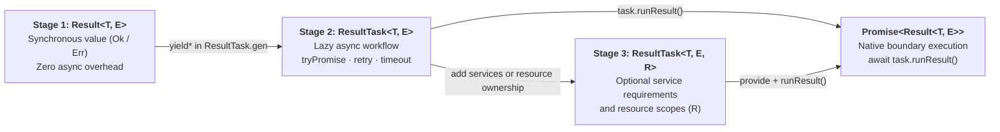

# Resultar

**Typed error handling and resilient workflows for TypeScript — from a single `Result<T, E>` to lazy, dependency-injected `ResultTask<T, E, R>`.**

[](https://nodejs.org)
[](packages/resultar/package.json)
[](packages/check/README.md)
[](LICENSE)

[Documentation](https://inaiat.github.io/resultar/) · [Quickstart](https://inaiat.github.io/resultar/#/docs/quickstart) · [Playground](https://inaiat.github.io/resultar/#/playground) · [Complete Guide](https://inaiat.github.io/resultar/#/docs/full-reference) · [API Inventory](https://inaiat.github.io/resultar/#/docs/api-inventory) · [Benchmarks](https://inaiat.github.io/resultar/#/docs/benchmarks) · [AI / Agent Skill (llms.txt)](llms.txt)

---

## Why Resultar in 30 Seconds

In standard TypeScript, `throw` and rejected promises are invisible in function signatures. Callers cannot tell what can fail—or whether every failure mode was handled—without reading the implementation of every transitive call.

```ts
// ❌ Standard TypeScript: the signature promises a number, but silently throws at runtime
const parsePort = (input: string): number => {
  const port = Number(input);
  if (!Number.isInteger(port) || port <= 0) {
    throw new Error(`Invalid port ${input}`); // invisible to the type checker!
  }
  return port;
};
```

Resultar moves expected failures into the return type, composes them linearly with `yield*`, and enforces exhaustive handling at your application boundary:

```ts
import { createTaggedError, ok, Result, ResultTask } from "resultar";

// 1. Define real Error subclasses with typed $prop interpolation, causes, and redaction
class InvalidEmailError extends createTaggedError({
  name: "InvalidEmailError",
  message: "Invalid email $email",
}) {}

class AccountExistsError extends createTaggedError({
  name: "AccountExistsError",
  message: "Account $email already exists",
}) {}

class DatabaseError extends createTaggedError({
  name: "DatabaseError",
  message: "Database $operation failed",
}) {}

// 2. Write pure domain functions with explicit Result<T, E> contracts
const normalizeEmail = (raw: string): Result<string, InvalidEmailError> => {
  const email = raw.trim().toLowerCase();
  return email.includes("@") ? ok(email) : InvalidEmailError.err({ email });
};

// 3. Compose sync + async steps linearly — TypeScript infers the exact error union
const registerAccount = (input: string) =>
  ResultTask.gen(function* () {
    const email = yield* normalizeEmail(input);

    if (email === "taken@example.com") {
      return yield* AccountExistsError.err({ email });
    }

    return yield* ResultTask.tryPromise({
      try: () => db.accounts.insert({ email }),
      catch: (cause) => new DatabaseError({ cause, operation: "insert-account" }),
    });
  });
// Inferred: ResultTask<Account, InvalidEmailError | AccountExistsError | DatabaseError>

// 4. Handle every failure exhaustively at the boundary (compile error if a tag is missed!)
const result = await registerAccount(req.body.email).runResult();
const response = result.matchTags((account) => ({ status: 201, body: account }), {
  InvalidEmailError: (err) => ({ status: 400, body: { code: err._tag, message: err.message } }),
  AccountExistsError: (err) => ({ status: 409, body: { code: err._tag, message: err.message } }),
  DatabaseError: (err) => ({ status: 503, body: { code: err._tag, message: err.message } }),
});
```

---

## Install

```sh
pnpm add resultar
# Optional native TypeScript-Go compiler + Resultar linter & LSP:
pnpm add -D resultar-check
```

Also published on JSR as [`@inaiat/resultar`](https://jsr.io/@inaiat/resultar).

---

## Philosophy: Why Resultar?

Resultar began as a fork of `neverthrow` and evolved to occupy the practical middle ground between lightweight `Result` boxes and full functional runtimes like `Effect`.

### 1. The Sweet Spot Between `neverthrow` and `Effect`

| Capability                                        | `neverthrow`                | `Resultar`                                                                            | `Effect`                                             |
| ------------------------------------------------- | --------------------------- | ------------------------------------------------------------------------------------- | ---------------------------------------------------- |
| **Entry cost**                                    | 1 function (`Result<T, E>`) | **1 function (`Result<T, E>`)**                                                       | Full `Effect<A, E, R>` ecosystem                     |
| **Async execution boundary**                      | `await ResultAsync<T, E>`   | **Explicit Task runners (`task.runResult()` returns native `Promise<Result<T, E>>`)** | `Effect.runPromise` / runtime                        |
| **Tagged `Error` classes & secret redaction**     | Manual                      | **Built-in (`createTaggedError`, `redact`)**                                          | Built-in (`Data.TaggedError`, `Redacted`)            |
| **Retries, timeouts, races & virtual clock**      | Manual                      | **Built-in (`Retry.policy`, `timeout`, `Clock.virtual`)**                             | Built-in (`Schedule`, `TestClock`)                   |
| **Typed DI (`R`), LIFO resource scopes & fibers** | No                          | **Opt-in via `ResultTask<T, E, R>` & `resultar-di`**                                  | Always present (`Effect<A, E, R>`, `Layer`, `Scope`) |
| **Native compiler enforcement (`noDiscard`)**     | ESLint plugin               | **Native TypeScript-Go CLI & LSP (`resultar-check`)**                                 | Language service plugin                              |

### 2. Adopt Gradually: Two Primitives, One Mental Model

Start with synchronous `Result` values and add `ResultTask` for asynchronous workflows. Executing a task with `task.runResult()` returns a native `Promise<Result<T, E>>` directly at your imperative boundary:



- **Stage 1 — `Result<T, E>`**: Use in pure parsing, validation, and domain functions.
- **Stage 2 — `ResultTask<T, E>`**: Use for all async operations, retries, timeouts, and HTTP requests. Build work lazily and execute it with `runResult`, `runExit`, `runPromise`, or `runFork`.
- **Stage 3 — `ResultTask<T, E, R>`**: Add typed service dependencies or owned resources when needed. Providing requirements leaves a Task that still needs an explicit runner.

> Upgrading from v4? Legacy `@deprecated` eager `ResultAsync` compatibility exports live in the isolated `"resultar/async"` subpath for incremental migration; see the [v5 migration guide](https://inaiat.github.io/resultar/#/docs/v5-migration).

New async repositories and use cases return `ResultTask`, without declaring their factories
`async`. Wrap external `Promise<T>` drivers directly with `ResultTask.tryPromise`. Framework callbacks and runners retain
their native Promise contracts. See [Promise boundaries](https://inaiat.github.io/resultar/#/docs/full-reference#promise-boundaries-and-application-contracts).

Prefer `task.runResult()`, `task.runPromise()`, `task.runExit()`, and `task.runFork()` at execution boundaries.
The static forms, such as `ResultTask.runResult(task, options)`, remain equivalent and supported.
Both forms enforce service requirements and accept the same execution options. `runResult` returns a native `Promise<Result<T, E>>`
that resolves typed errors as `Err` (and rejects defects, interruption, and composite causes); `runPromise` resolves
the value or rejects, `runExit` preserves every outcome as a value, and `runFork` starts a root fiber
immediately. Each call starts a new execution. See the [runner reference](https://inaiat.github.io/resultar/#/docs/core-guide#lazy-workflows-with-resulttask).

```ts
import { createTaggedError, ok, Result, ResultTask, Retry } from "resultar";

class InvalidIdError extends createTaggedError({
  name: "InvalidIdError",
  message: "Invalid id $id",
}) {}
class UserNotFoundError extends createTaggedError({
  name: "UserNotFoundError",
  message: "User $id not found",
}) {}

// Stage 1: Synchronous Result<T, E>
const parseUserId = (raw: string): Result<string, InvalidIdError> =>
  raw.startsWith("usr_") ? ok(raw) : InvalidIdError.err({ id: raw });

// Stage 2: Requirement-free ResultTask<T, E>, executed at an explicit boundary
const fetchProfile = (id: string) =>
  ResultTask.tryPromise({
    try: (signal) => fetch(`https://api.example.com/users/${id}`, { signal }).then((r) => r.json()),
    catch: (cause) => new UserNotFoundError({ id, cause }),
  }).retry(Retry.policy({ times: 2, delayMs: 50 }));

// Stage 3: Add typed service requirements and tagged recovery to the same Task model
const AuditLog = ResultTask.service<{ record(id: string): ResultTask<void> }>()("AuditLog");

const loadAndAuditUser = ResultTask.fn(
  function* (rawId: string) {
    const id = yield* parseUserId(rawId); // Stage 1 yielded directly
    const user = yield* fetchProfile(id); // Stage 2 yielded directly
    const audit = yield* AuditLog; // Stage 3 adds R = Service<'AuditLog', ...>
    yield* audit.record(id);
    return user;
  },
  ResultTask.catchTag("UserNotFoundError", (err) => ok({ id: err.id, guest: true })),
);
// Inferred: (rawId: string) => ResultTask<User | Guest, InvalidIdError, Service<'AuditLog', ...>>
```

### 3. Sync-First, Pay-As-You-Go Execution Engine

Resultar's runtime is engineered so that gradual adoption is also **pay-as-you-go at runtime**:

- **Zero-microtask synchronous fast path**: `Result.gen`, synchronous `ResultTask` pipelines, and `ResultTask.scoped` workflows without async steps execute inside a tight synchronous `while` loop (`runTaskLoop` / `#runGen`) without scheduling microtasks. On the happy path, the engine reuses static singletons (`sharedSuccessExit`, `idleTaskIterator`, `idleRunContext`) until it encounters a real `Promise` or an explicit `yieldEvery` checkpoint.
- **Services and owned fibers are optional**: Ordinary tasks can run with `R = never`; introduce `service()`, `acquireRelease()`, and `forkChild()` when the workflow needs them.
- **Bounded concurrency by construction**: Collection operators like `ResultTask.forEach(items, fn, { concurrency: 8 })` use a fixed worker-loop pool without per-item fiber scheduling overhead.

> For the cost of `await task.runResult()` and of migrating an eager workflow, see [v5 versus published v4](benchmarks/README.md#v5-versus-published-v4). The [benchmark guide](https://inaiat.github.io/resultar/#/docs/benchmarks) also covers `neverthrow` and `effect`.

---

## Core Capabilities

### Production Tagged Errors & Secret Redaction

`createTaggedError` creates real `Error` subclasses (`instanceof Error === true`) with a literal `_tag`, `$variable` message interpolation, stable log `.fingerprint` tuples (`[tag, template]`), `.findCause(ErrorClass)` traversal, opt-out `captureStackTrace: false` for hot-path expected errors, and first-class secret redaction:

```ts
import { createTaggedError, isRedacted, redact, revealRedacted } from "resultar";

class TokenRejectedError extends createTaggedError({
  name: "TokenRejectedError",
  message: "Token $token rejected for tenant $tenantId",
}).withProps<{ token: unknown; tenantId: string }>() {}

const err = new TokenRejectedError({
  token: redact("sk_live_987654321", "stripe-key"),
  tenantId: "t_42",
  cause: new Error("expired signature"),
});

err.message; // 'Token <redacted:stripe-key> rejected for tenant t_42'
err.fingerprint; // ['TokenRejectedError', 'Token $token rejected for tenant $tenantId']
err.toJSON(); // safe for structured loggers — redacted value is never serialized

if (isRedacted(err.token)) {
  revealRedacted(err.token); // 'sk_live_987654321' (explicit unwrap when needed)
}
```

### Resource Scopes (`acquireRelease`), Concurrency & Virtual Clock

Tie connections, file handles, or transactions to a scope with `ResultTask.acquireRelease` or `ResultTask.acquireDisposable`. Finalizers always run in reverse acquisition order (**LIFO**)—even on typed failure, unexpected defect, timeout, or fiber interruption:

```ts
import { Clock, Fiber, ResultTask } from "resultar";

const withDatabase = ResultTask.acquireRelease({
  acquire: ResultTask.tryPromise({
    try: (signal) => pool.connect(signal),
    catch: (cause) => new ConnectionError({ cause }),
  }),
  release: (client, exit) => ResultTask.sync(() => client.release(exit._tag === "Failure")),
});

const program = ResultTask.scoped(
  ResultTask.gen(function* () {
    const client = yield* withDatabase;
    // Fork a scope-owned background fiber that is automatically interrupted if parent fails
    const metricsFiber = yield* ResultTask.forkChild(
      ResultTask.sync(() => recordQueryStart()).delay(100),
    );
    const rows = yield* queryUsers(client).timeout(1_500, () => new QueryTimeoutError());
    yield* Fiber.join(metricsFiber);
    return rows;
  }),
);

// Test timeouts and retries deterministically in 0ms of wall-clock time:
const clock = Clock.virtual();
const pending = program.runResult({ clock });
await clock.advanceBy(1_500);
const result = await pending;
```

### Exhaustive Pattern Matching (`Match`)

`Match` provides type-narrowing pattern matching over tagged unions, custom discriminators, literals, predicates, and HTTP route contexts. Pure tag tables compile down to $O(1)$ object dispatch:

```ts
import { Match } from "resultar";

type BillingEvent =
  | { _tag: "InvoicePaid"; amountCents: number }
  | { _tag: "InvoiceFailed"; reason: string };

const formatEvent = Match.type<BillingEvent>().tagsExhaustive({
  InvoicePaid: (e) => `Paid $${(e.amountCents / 100).toFixed(2)}`,
  InvoiceFailed: (e) => `Failed: ${e.reason}`,
});
```

---

## Compiler-Enforced Safety (`resultar-check`)

A `Result` only protects your application if callers actually handle it. [`resultar-check`](https://inaiat.github.io/resultar/#/docs/resultar-check) is a native **TypeScript-Go** CLI and LSP server that runs full TypeScript typechecking and Resultar-specific static analysis in a single native pass:

```sh
pnpm add -D resultar-check
```

```json
{
  "$schema": "./node_modules/resultar-check/schema.json",
  "compilerOptions": {
    "plugins": [
      {
        "name": "resultar-check",
        "diagnosticSeverity": "error",
        "noDiscardMode": "must-use",
        "noUnsafeAwaitMode": "all",
        "failOn": "error",
        "ignoreFilePatterns": ["tests/**", "vite.config.ts"]
      }
    ]
  }
}
```

- **43 native static analysis rules (`RESULTAR001`–`RESULTAR043`)**: Forbids accidental `await task` (`noAwaitResultTask`), ignored `Result` / `ResultAsync` / `ResultTask` / `MatchMatcher` / `Fiber` values (`noDiscard`), `unknown` / `any` error or service channels (`noUnknownResultError`, `noUnknownTaskRequirements`), `Promise<ResultTask<...>>` leaks (`noPromiseResultar`), generator mistakes (`yieldStarInResultTaskGen`, `noAwaitInResultTaskGen`, `requireReturnYieldStar`, `noResultInTaskGen`, `noRunInsideGen`), unscoped resources (`noUnscopedAcquireRelease`), invalid DI lifetimes (`noInvalidLifetime`), and non-idiomatic combinator chains.
- **Auto-fix, `migrate-v5`, CI, Multi-Editor & AI Agent ready**: Apply safe semantic corrections automatically with `resultar-check --fix` (or preview via `--fix-dry-run` / `quickfixes --json`), automate v4 -> v5 upgrades with `resultar-check migrate-v5`, inspect codebase topology with `overview --json`, emit human/JSON/SARIF/JUnit reports, run `resultar-check lsp`, use the official [VS Code & Cursor LSP extension](https://inaiat.github.io/resultar/#/docs/vscode-extension) (inline `T / E / R` hover and quickfixes), and scaffold editor setup with `resultar-check init --editor zed|vscode|cursor|all`. See the [Anti-Patterns & `resultar-check` Guide](https://inaiat.github.io/resultar/#/docs/agents/anti-patterns) for repair guidance and the complete diagnostic reference.

---

## Ecosystem Packages

Use [`resultar-app`](https://inaiat.github.io/resultar/#/docs/packages/app) for a unified installation and import
entry point covering workflows, DI and configuration. The component packages also
support independent use: install `resultar` for `import { Result } from 'resultar'`,
or install only `resultar-app` and import `Result` from `'resultar-app'`. Declare each
package you import directly as an application dependency.

The Resultar monorepo ships companion packages for DI, configuration, HTTP clients,
schema validation, and web frameworks:

| Package                    | Description                                                                                                                                                                                                                                                                                                                                                      | Docs                                                                                                                           |
| -------------------------- | ---------------------------------------------------------------------------------------------------------------------------------------------------------------------------------------------------------------------------------------------------------------------------------------------------------------------------------------------------------------- | ------------------------------------------------------------------------------------------------------------------------------ |
| `resultar`                 | Core `Result<T, E>`, `ResultTask<T, E, R>`, `Match`, `Cause`, `Retry`, `Clock`, `Fiber`, `Semaphore`, `Deferred`, `Queue`, `Ref`, `TaskLocal`, `Tracer`, opt-in `resultar/async` compat, plus tree-shakeable subpath exports (`resultar/result`, `resultar/task`, `resultar/match`, `resultar/tagged`, `resultar/retry`, `resultar/function`, `resultar/async`). | [Docs](https://inaiat.github.io/resultar/#/docs/core-guide) · [Guide](https://inaiat.github.io/resultar/#/docs/full-reference) |
| `resultar-check`           | Native TypeScript-Go compiler + 43 Resultar diagnostics, `--fix`, `migrate-v5`, LSP server, and Zed/VS Code/Cursor setup.                                                                                                                                                                                                                                        | [Docs](https://inaiat.github.io/resultar/#/docs/resultar-check)                                                                |
| `resultar-app`             | Unified entry point for workflows, dependency injection and validated configuration.                                                                                                                                                                                                                                                                             | [Docs](https://inaiat.github.io/resultar/#/docs/packages/app)                                                                  |
| `resultar-config`          | Lazy, typed Node environment configuration with TypeBox schemas, secret sanitization, and DI startup ordering.                                                                                                                                                                                                                                                   | [Docs](https://inaiat.github.io/resultar/#/docs/packages/config)                                                               |
| `resultar-di`              | Typed dependency injection, class/function services, request scopes, and test overrides for `ResultTask`.                                                                                                                                                                                                                                                        | [Docs](https://inaiat.github.io/resultar/#/docs/packages/di)                                                                   |
| `resultar-hono`            | Typed Hono middleware & bindings with one DI resource scope per HTTP response and graceful shutdown.                                                                                                                                                                                                                                                             | [Docs](https://inaiat.github.io/resultar/#/docs/packages/hono)                                                                 |
| `resultar-fastify`         | Native Fastify plugin providing application & request-scoped DI services, cancellation, and cleanup.                                                                                                                                                                                                                                                             | [Docs](https://inaiat.github.io/resultar/#/docs/packages/fastify)                                                              |
| `resultar-nestjs`          | Native NestJS module & `@Services()` decorator providing application & request-scoped DI services, cancellation, and cleanup.                                                                                                                                                                                                                                    | [Docs](https://inaiat.github.io/resultar/#/docs/packages/nestjs)                                                               |
| `resultar-request`         | Fetch-first JSON HTTP client returning lazy, cancelable `ResultTask` workflows.                                                                                                                                                                                                                                                                                  | [Docs](https://inaiat.github.io/resultar/#/docs/packages/request)                                                              |
| `resultar-request-zod`     | Zod schema validation adapter for `resultar-request`.                                                                                                                                                                                                                                                                                                            | [Docs](https://inaiat.github.io/resultar/#/docs/packages/request-zod)                                                          |
| `resultar-request-typebox` | TypeBox schema validation adapter for `resultar-request`.                                                                                                                                                                                                                                                                                                        | [Docs](https://inaiat.github.io/resultar/#/docs/packages/request-typebox)                                                      |

For Node process startup, signal handling, and HTTP draining with typed configuration, see [`resultar-config`](https://inaiat.github.io/resultar/#/docs/packages/config) and the [Node lifecycle recipe](examples/cookbook/src/node-lifecycle.ts).

### End-to-End Web Service Example (`resultar-di` + `resultar-hono` / `resultar-fastify` / `resultar-nestjs`)

Define services once with `resultar-di` and expose them to Hono, Fastify, or NestJS routes with automatic per-request resource cleanup and inferred `c.env` / `request.services` / `@Services()` types:

```ts
import { createTaggedError, ResultTask } from "resultar";
import { createHonoApp, createModule, Service } from "resultar-hono";

class UserNotFoundError extends createTaggedError({
  name: "UserNotFoundError",
  message: "User $id was not found",
}) {}

class Users extends Service("users", {
  make: () => ({
    findById: (id: string) =>
      id === "1" ? ResultTask.ok({ id, name: "Ada Lovelace" }) : UserNotFoundError.taskErr({ id }),
  }),
}) {}

const services = createModule().scoped(Users);

export const app = createHonoApp({ services }, (router) => {
  router.get("/users/:id", async (c) => {
    const result = await c.env.users.findById(c.req.param("id")).runResult();
    return result.matchTags((user) => c.json(user, 200), {
      UserNotFoundError: (err) => c.json({ error: err.message }, 404),
    });
  });
});
```

---

## First-Class Coding Agent Support

Install `resultar-check` as a development dependency (`pnpm add -D resultar-check`) for offline coding-agent instructions. Start at `node_modules/resultar-check/dist/agent/SKILL.md`. The accompanying `versions.json` records the runtime and companion versions used by the guide.

- **[`SKILL.md`](https://inaiat.github.io/resultar/#/docs/agents/skill)**: Execution contracts and routing to the relevant manual for Claude Code, Cursor, Codex, and Antigravity.
- **[`references/api.md`](https://inaiat.github.io/resultar/#/docs/agents/api)**: Feature map and semantic constraints across `Result`, `ResultTask`, `createTaggedError`, `taggedEnum`, `redact`, `Match`, `Cause`, `Fiber`, `Semaphore`, `Retry`, `Clock`, and `Scheduler`.
- **[`references/anti-patterns.md`](https://inaiat.github.io/resultar/#/docs/agents/anti-patterns)**: Native checker configuration, repair patterns, and links to all 43 rules and their verified defaults.
- **[`references/patterns.md`](https://inaiat.github.io/resultar/#/docs/agents/patterns)**: Production recipes (`ResultTask.memoize`, `onExit`, background workers with `runFork`, uncooperative Promise timeouts with `interruption: 'detach'`, bounded concurrency, and `VirtualClock` testing).
- **[`references/services.md`](https://inaiat.github.io/resultar/#/docs/agents/services)**: `serviceTag`, `resultar-di`, `resultar-hono`, `resultar-fastify`, `resultar-nestjs`, and `resultar-request` (`zod` and `typebox`).
- **[`references/integrations.md`](https://inaiat.github.io/resultar/#/docs/agents/integrations)** & **[`references/review-checklist.md`](https://inaiat.github.io/resultar/#/docs/agents/review-checklist)**: Boundary adapters and pre-commit review checklist.
- **[Public API inventory](https://inaiat.github.io/resultar/#/docs/api-inventory) and [executable recipes](https://inaiat.github.io/resultar/#/docs/recipes)**: Generated from declarations and compiled recipe sources; checked by `vp run test:docs`. The full guide and companion READMEs are also bundled under `dist/agent/manual/`.
- **`node_modules/resultar-check/dist/llms.txt`**: Structured index of the public surface and bundled reference guides.
- **Executable agent evaluation suite**: Run `pnpm test:agents` in this workspace to verify coding-agent contracts and grading harnesses (see [`skills/resultar/evals/README.md`](skills/resultar/evals/README.md)).

---

## Runnable Examples

Explore complete, runnable projects in [`examples/`](examples):

| Example                                  | Stack                              | What it demonstrates                                                                                                              |
| ---------------------------------------- | ---------------------------------- | --------------------------------------------------------------------------------------------------------------------------------- |
| [`examples/cookbook`](examples/cookbook) | Core `resultar` cookbook           | Sync validation, `Result.gen`, tagged errors, `ResultTask` resilience, fibers, and resource cleanup (`pnpm run example:cookbook`) |
| [`examples/check`](examples/check)       | `resultar-check`                   | Every compiler rule finding plus a zero-diagnostic clean reference project                                                        |
| [`examples/request`](examples/request)   | `resultar-request` + Zod / TypeBox | Fetch-first JSON requests with schema validation, retries, and typed HTTP error handling                                          |
| [`examples/hono`](examples/hono)         | `resultar-hono` + `resultar-di`    | Class services, inferred `AppHono` bindings, test overrides, and per-response DI scopes                                           |
| [`examples/fastify`](examples/fastify)   | `resultar-fastify` + `resultar-di` | Application/request DI scopes, TypeBox routes, and explicit HTTP boundary mapping                                                 |
| [`examples/nestjs`](examples/nestjs)     | `resultar-nestjs` + `resultar-di`  | Native NestJS controllers, `@Services()` injection, application/request DI scopes, and explicit HTTP boundary mapping             |

---

## Documentation Map

The [documentation website](https://inaiat.github.io/resultar/) includes these guides and the interactive playground. The [Markdown reference](DOCUMENTATION.md) is available in the repository and bundled with the `resultar-check` npm package.

| Topic                                                                       | Guide                                                                                                                                |
| --------------------------------------------------------------------------- | ------------------------------------------------------------------------------------------------------------------------------------ |
| **Coming from Effect**                                                      | [Coming from Effect](https://inaiat.github.io/resultar/#/docs/coming-from-effect)                                                    |
| **Gradual Adoption (`Result` → `ResultTask`)**                              | [Gradual adoption](https://inaiat.github.io/resultar/#/docs/gradual-adoption)                                                        |
| **Core Package Quickstart & Cookbook**                                      | [Core package guide](https://inaiat.github.io/resultar/#/docs/core-guide)                                                            |
| **The Core Model (`Ok`, `Err`, `ResultTask`)**                              | [The model](https://inaiat.github.io/resultar/#/docs/full-reference#the-model)                                                       |
| **Tagged Errors, `.withProps()`, & Redaction**                              | [Tagged errors](https://inaiat.github.io/resultar/#/docs/full-reference#tagged-errors)                                               |
| **Linear Generators (`Result.gen`, `Result.fn`, `ResultTask.fn`)**          | [Generators](https://inaiat.github.io/resultar/#/docs/full-reference#result-generators)                                              |
| **Lazy Tasks, Services (`R`), & Resource Scopes**                           | [Tasks and services](https://inaiat.github.io/resultar/#/docs/full-reference#lazy-tasks-and-service-requirements)                    |
| **Structured Concurrency (`Fiber`, `Semaphore`, `Scheduler`)**              | [Structured concurrency](https://inaiat.github.io/resultar/#/docs/full-reference#structured-task-concurrency-fibers-and-semaphores)  |
| **Racing, Timeouts, & Deterministic `Clock.virtual`**                       | [Racing, timeouts and clocks](https://inaiat.github.io/resultar/#/docs/full-reference#task-racing-timeouts-timing-and-virtual-clock) |
| **Portable Retry Policies (`Retry.policy`)**                                | [Retry policies](https://inaiat.github.io/resultar/#/docs/full-reference#portable-retry-policies-and-resulttask-retry)               |
| **Pattern Matching (`Match`)**                                              | [Pattern matching](https://inaiat.github.io/resultar/#/docs/full-reference#pattern-matching)                                         |
| **Compiler Diagnostics (`resultar-check`)**                                 | [Native checker](https://inaiat.github.io/resultar/#/docs/resultar-check)                                                            |
| **Performance Benchmarks (`resultar` vs `effect` vs `neverthrow`)**         | [Benchmark results](https://inaiat.github.io/resultar/#/docs/benchmarks)                                                             |
| **v5 Migration Guide (`Result` + `ResultTask` Unification)**                | [v5 migration](https://inaiat.github.io/resultar/#/docs/v5-migration)                                                                |
| **v4 Migration & Compatibility Notes (Historical)**                         | [v4 migration](https://inaiat.github.io/resultar/#/docs/v4-migration)                                                                |
| **Complete Public API Map**                                                 | [Complete API map](https://inaiat.github.io/resultar/#/docs/full-reference#api-map)                                                  |

---

## Workspace Development

Requirements: **Node.js 24+**, **pnpm 12**, ESM-only. Use the exact pnpm version pinned in `package.json` (`packageManager`).

```sh
pnpm install          # Install workspace dependencies
pnpm check:full       # Run Vite+ formatting/lint/type checks, fallow analysis, and the full test suite
pnpm build            # Build all workspace packages
pnpm smoke:package    # Verify packed tarballs, exports, and published artifacts
pnpm test:examples    # Run smoke tests across all example projects
pnpm test:agents      # Validate coding-agent skill contracts
pnpm test:vscode      # Build and test the VS Code / Cursor extension against live resultar-check lsp
pnpm docs:dev         # Launch the searchable docs portal & live browser playground locally
pnpm test:website     # Build and test the docs portal, search index, and playground presets
```

Reproducible benchmarks live in [`benchmarks/`](https://inaiat.github.io/resultar/#/docs/benchmarks) (`pnpm --filter resultar-benchmarks run bench:effect`, `bench:neverthrow`, `bench:task`). Releases are managed with Changesets (`pnpm changeset`).

## License

[MIT](LICENSE)
