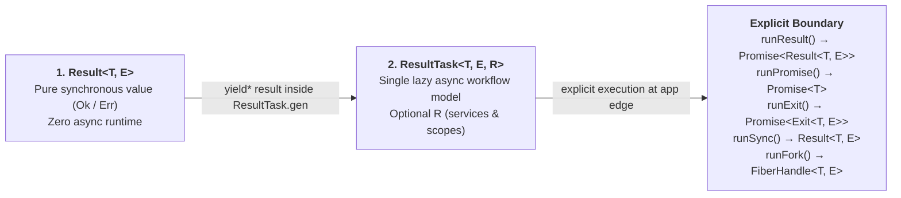

# RFC 0012: v5 Unified Async Model, `ResultTask` / `ResultAsync` Decoupling, and Ecosystem Alignment

- Status: Implemented (Validated; Awaiting Release)
- Date: 2026-11-20 (Implemented 2026-11-21)
- Target packages: `resultar`, `resultar-app`, `resultar-check`, `resultar-di`, `resultar-hono`, `resultar-fastify`, `resultar-nestjs`, `resultar-request`, `resultar-request-zod`, `resultar-request-typebox`
- References: [RFC 0001](./rfc-0001-result-task-core.md), [RFC 0004](./rfc-0004-effect-v4-ergonomics-and-tooling.md), [RFC 0005](./rfc-0005-contract-safety-http-and-ai-validation.md), [RFC 0006](./rfc-0006-task-cancellation-and-recovery.md), [RFC 0007](./rfc-0007-task-promise-defect-boundary.md), [RFC 0009](./rfc-0009-inference-scopes-and-application-lifecycle.md), [RFC 0010](./rfc-0010-dx-observability-concurrency-and-tooling.md), [RFC 0011](./rfc-0011-jit-compilation-and-runtime-performance.md)

---

## Summary

Resultar v4 introduced `ResultTask<T, E, R>` as the recommended default for asynchronous workflows while retaining `ResultAsync<T, E>` both as a backwards-compatibility layer and as the return type of `task.runResult()`. In practice, this compromise leaves **two overlapping asynchronous models** active in the root `"resultar"` package, creates sharp semantic traps where identical method names behave oppositely between `ResultAsync` and `ResultTask`, produces mixed signals across official examples and `resultar-check`, and couples `ResultTask` to `ResultAsync` via a global side-effect registry that breaks `"sideEffects": false` tree-shaking on `resultar/task`.

**Resultar v5** establishes a single, unambiguous two-primitive core mental model:

1. **`Result<T, E>`** — Pure synchronous fallible value (`Ok<T> | Err<E>`), with zero async coupling.
2. **`ResultTask<T, E, R>`** — The **only** asynchronous workflow primitive in `"resultar"`, executed explicitly at boundaries.

This RFC proposes five coordinated changes for v5 (plus a non-breaking v4.x prerequisite phase):

1. **Decouple `task.runResult()` from `ResultAsync`**: `task.runResult()` and `ResultTask.runResult(task)` return a native **`Promise<Result<A, E | ScopeError<R>>>`**, removing the global `registerResultAsyncFactory` side-effect registry and making `resultar/task` and `resultar/result` genuinely standalone and tree-shakeable.
2. **Move `ResultAsync` out of the root `"resultar"` barrel as a deprecated compatibility-only entry**: Support the v4 `ResultAsync` class, its eager helpers and associated types at `resultar/async` throughout v5.x strictly as a **`@deprecated` compatibility layer** for incremental migration (candidate for removal in a future major). Move the async generator overloads and the eager transforms on `Result` to explicitly imported equivalents in `resultar/async` (§3.3). Consumers can upgrade a service while retaining its in-flight `StrictResultAsync` contract.
3. **Clarify operator behavior**: On a Task, `tryPromise` maps rejections to typed failures, `tap` composes fallible effects and `match` builds another Task. On a settled `Result`, `match` returns the handler's output immediately. The v4 eager operators retain their documented semantics on the compatibility entry.
4. **Unify companion packages around `ResultTask`**: Make `resultar-request` (`requestJson`, `requestJsonZod`, `requestJsonTypeBox`) Task-native by default, remove internal deprecated `ResultAsync.fromCallback` usage in `resultar-di` / `resultar-hono` / `resultar-fastify` / `resultar-nestjs`, and align all official examples to `ResultTask`.
5. **Align `resultar-check` and provide a v4 → v5 migration path**: Add `no-await-result-task` (catching unexecuted `await task` at error severity), update `no-promise-resultar` and `prefer-tap` / `prefer-tap-error`, turn off legacy `prefer-result-async` by default (moving it to optional eager-compat policy), and ship a migration guide and codemod that report calls requiring a decision about execution timing or error handling.

---

## 1. Problem Statement and Audited Evidence

A workspace-wide DX and architecture audit of v4.1 (`cacb729`) revealed four concrete problems caused by the ongoing overlap between `ResultTask` and `ResultAsync`.

### 1.1 Two competing async models in the root package

Although [README.md](../../README.md), [packages/resultar/README.md](../../packages/resultar/README.md), and [docs/migrations/v4.md](../migrations/v4.md) frame `ResultAsync` as _"an in-flight `Result` returned by `task.runResult()` plus deprecated v3 compatibility"_, the actual exported surface tells a different story:

- **`ResultAsync` remains a full-featured active API**: [result-async.ts](../../packages/resultar/src/result-async/result-async.ts) exposes **55 static members and 25 instance members**. While ~18 static orchestration helpers (`all`, `combine`, `forEach`, `validateAll`, `retry*`, `race*`, `timeout`, `withResource`, `loop`, `iterate`, `zip`, `fromCallback`, `fromThrowable`, `fromTask`, `firstSuccessOf`) are `@deprecated`, the root barrel ([packages/resultar/src/index.ts](../../packages/resultar/src/index.ts)) still exports active, non-deprecated constructors (`okAsync`, `errAsync`, `unitAsync`, `fromPromise`, `fromSafePromise`, `tryResultAsync`) and full active composition/branching/matching operators (`map`, `mapErr`, `andThen`, `orElse`, `orElseSucceed`, `catchTag*`, `catchReason*`, `filterOrElse`, `if`, `when*`, `unless*`, `as`, `asVoid`, `inspect*`, `log`, `match*`, `unwrapOr*`, `pipe`).
- **Two active async generator systems**: `Result.gen(async function* () ...)` and `Result.fn(async function* () ...)` ([result.ts](../../packages/resultar/src/result/result.ts)) are non-deprecated and return `ResultAsync<T, E>`, directly competing with `ResultTask.gen(function* () ...)` and `ResultTask.fn`.
- **Stage 1 (`Result`) still pushes users into `ResultAsync`**: `result.asyncMap(...)`, `result.asyncAndThen(...)`, `Result.asyncMap`, and `Result.asyncAndThen` ([result.ts](../../packages/resultar/src/result/result.ts)) are active methods on `Result`. Developers starting with `Result<T, E>` discover `asyncMap` / `asyncAndThen` in IDE autocomplete and adopt `ResultAsync` before ever encountering `ResultTask`.
- **Duplicated HTTP client surface**: [resultar-request](../../packages/request/README.md) and its Zod/TypeBox adapters maintain parallel active APIs (`requestJson` vs `requestJsonTask`, `requestJsonZod` vs `requestJsonZodTask`, `requestJsonTypeBox` vs `requestJsonTypeBoxTask`) plus ~25 mirrored input/retry types.

### 1.2 Semantic inversions between identically named APIs

When a codebase (or developer) touches both `ResultAsync` and `ResultTask`, identically named APIs exhibit opposite or incompatible semantics:

| Concept / Method                                            | `ResultAsync` behavior                                                                                                                                                                                         | `ResultTask` behavior                                                                                                                                                                                                                                                    | DX hazard                                                                                                                                                    |
| ----------------------------------------------------------- | -------------------------------------------------------------------------------------------------------------------------------------------------------------------------------------------------------------- | ------------------------------------------------------------------------------------------------------------------------------------------------------------------------------------------------------------------------------------------------------------------------ | ------------------------------------------------------------------------------------------------------------------------------------------------------------ |
| **`fromPromise`**                                           | `fromPromise(promise, errorFn)` accepts an **already-started Promise** + **error mapper**; rejections become typed **`Err<E>`** ([result-async.ts](../../packages/resultar/src/result-async/result-async.ts)). | `ResultTask.fromPromise(signal => promise)` accepts a **lazy factory** with **no error mapper**; returns `ResultTask<A, never>` and rejections become **defects (`Die`)** that reject `runResult()` ([result-task.ts](../../packages/resultar/src/task/result-task.ts)). | **Exact naming inversion**: `ResultAsync.fromPromise` maps to `ResultTask.tryPromise`, while `ResultTask.fromPromise` maps to `ResultAsync.fromSafePromise`. |
| **`try`**                                                   | `ResultAsync.try(fnOrPromise, catchFn)` wraps Promises / async factories.                                                                                                                                      | `ResultTask.try(fn, catchFn)` is **sync-only** (`Exclude<A, Promise<unknown>>`); async requires `ResultTask.tryPromise`.                                                                                                                                                 | Friction whenever switching from `ResultAsync.try` to `ResultTask`.                                                                                          |
| **`map` / `mapErr`**                                        | Both await Promise-returning callbacks.                                                                                                                                                                        | `map` stores the callback's return value in the success channel. `mapErr` stores it in the failure channel. Either can therefore carry a Promise as its payload.                                                                                                         | Porting an async callback directly changes the type of the settled value or error.                                                                           |
| **`tap` / `tapError`**                                      | `@deprecated` **best-effort** observers (swallow thrown errors and rejections; aliases of `inspect` / `inspectError`).                                                                                         | **Canonical fallible** effect composition (`ResultTask<A, E \| E2, R \| R2>`; throws become `Cause.Die`).                                                                                                                                                                | Identical names with opposite error-handling contracts.                                                                                                      |
| **`match` / `matchTags` / `matchTagsPartial` / `unwrapOr`** | **Instance**: terminal `Promise<Out>`. **Static/curried**: composable `ResultAsync<Out, never>`.                                                                                                               | **Instance & static**: lazy operator `ResultTask<Out, never, R>`.                                                                                                                                                                                                        | Four distinct return shapes across `Result`, `ResultAsync` instance, `ResultAsync` static, and `ResultTask`.                                                 |
| **`await` behavior**                                        | `PromiseLike`: `await asyncVal` observes the `Result<T, E>` of an execution already in flight.                                                                                                                 | Not thenable: `await task` silently resolves to the unexecuted `ResultTask` object.                                                                                                                                                                                      | TypeScript allows `await` on non-thenables; mixing both types makes missing `.runResult()` easy to slip past review.                                         |
| **`yield*` & `andThen` interop**                            | Accepts `Result` and `ResultAsync`; rejects `ResultTask`.                                                                                                                                                      | Accepts `Result`, `ResultTask`, and `ServiceTag`; rejects `ResultAsync`.                                                                                                                                                                                                 | Two closed worlds requiring manual `ResultTask.fromResultAsync(() => ...)` bridging.                                                                         |
| **Cancellation channel**                                    | `requestJson` and `ResultAsync.fromCallback` place aborts into typed `E` (`RequestError` / `AbortError`).                                                                                                      | `requestJsonTask` and `ResultTask.fromCallback` surface aborts as `Cause.Interrupt` (outside `E`).                                                                                                                                                                       | Same `AbortSignal` yields `Err` in one world and interruption/rejection in the other.                                                                        |

### 1.3 Architectural defects from `task.runResult()` returning `ResultAsync`

Returning `ResultAsync<A, E>` from `task.runResult()` ([result-task.ts](../../packages/resultar/src/task/result-task.ts)) introduces four structural drawbacks:

1. **Broken subpath tree-shaking under `"sideEffects": false` (confirmed runtime bug in v4.1)**:
   - [result-task.ts](../../packages/resultar/src/task/result-task.ts) relies on a bare side-effect import (`import '../result-async/result-async.js'`) so `result-async.ts` registers its constructor via `registerResultAsyncFactory(...)` (`packages/resultar/src/result-async/result-async-adapter.ts`, removed in v5).
   - Because [packages/resultar/package.json](../../packages/resultar/package.json) declares `"sideEffects": false`, the bundler strips that side-effect import from `dist/task.js` (`resultar/task`).
   - Executing `import { ResultTask } from 'resultar/task'; await ResultTask.ok(42).runResult()` crashes at runtime with `Error: ResultAsync is not registered`. The same crash occurs for `import { ok } from 'resultar/result'; await ok(42).asyncMap(async (x) => x + 1)`.
2. **Non-native `PromiseLike` boundary friction**:
   - Because `ResultAsync` implements `PromiseLike` rather than extending `Promise`, standard Promise boundary code (`task.runResult().catch(...)`, `task.runResult().finally(...)`, `assert.rejects(task.runResult())`) fails unless manually wrapped in `Promise.resolve(...)` (documented as a caveat in [docs/migrations/v4.md](../migrations/v4.md)).
3. **Post-execution semantic cliff**:
   - Calling `task.runResult().map(...).andThen(...)` looks syntactically identical to `task.map(...).andThen(...)`, yet silently leaves the `ResultTask` runtime: retries, `Clock.virtual`, `TaskScope` finalizers, `Tracer` spans, and `Cause.Die` capture no longer apply to chained operations after `.runResult()`.
4. **Forced conceptual surface on day one**:
   - Even greenfield v4 projects that never intend to use `ResultAsync` immediately see `ResultAsync<T, E>` in hover types on every `.runResult()` call.

### 1.4 Contradictory signals across official examples, companion packages, and `resultar-check`

1. **Examples contradict the README**:
   - [README.md](../../README.md) teaches `resultar-hono` services returning `ResultTask` and routes calling `.runResult()`.
   - Yet [examples/hono/src/services.ts](../../examples/hono/src/services.ts), [examples/fastify/src/services.ts](../../examples/fastify/src/services.ts), and [examples/nestjs/src/services.ts](../../examples/nestjs/src/services.ts) return `StrictResultAsync` via `okAsync` and `Result.gen(async function* ...)`, and routes directly `await` service methods without `.runResult()` ([examples/hono/src/routes.ts](../../examples/hono/src/routes.ts)).
   - [packages/resultar/README.md](../../packages/resultar/README.md) also shows `const result = await users.findById(id)` in its `Match.context` Hono snippet, while [examples/request/src/typebox.ts](../../examples/request/src/typebox.ts), [examples/request/src/zod.ts](../../examples/request/src/zod.ts), and [examples/request/src/server.ts](../../examples/request/src/server.ts) still use deprecated `ResultAsync.withResource`, `ResultAsync.fromCallback`, and `runPromise`.
2. **Companion packages expose `ResultAsync` and call deprecated APIs internally**:
   - `resultar-di` ([packages/di/src/task-session.ts](../../packages/di/src/task-session.ts)), `resultar-hono` ([packages/hono/src/index.ts](../../packages/hono/src/index.ts), [packages/hono/src/middleware.ts](../../packages/hono/src/middleware.ts)), `resultar-fastify` ([packages/fastify/src/session.ts](../../packages/fastify/src/session.ts)), and `resultar-nestjs` ([packages/nestjs/src/session.ts](../../packages/nestjs/src/session.ts)) expose `ResultAsync` on `ready` / `close` lifecycle methods and internally call `@deprecated` `ResultAsync.fromCallback`.
3. **`resultar-check` defaults and autofixes pull back toward `ResultAsync`**:
   - `preferResultAsync` still defaults to `"warning"` ([packages/check/schema.json](../../packages/check/schema.json)) while `failOn` defaults to `"message"`, requiring every Task-first project to manually add `"preferResultAsync": "off"`.
   - `noPromiseInResultSuccess` still describes itself as _"use asyncMap or ResultAsync"_ ([packages/check/schema.json](../../packages/check/schema.json)).
   - `prefer-tap` and `prefer-tap-error` ([packages/check/native/internal/analyzer/rules.go](../../packages/check/native/internal/analyzer/rules.go)) only switch their suggestion to `inspect` / `inspectError` when `isResultarSyncType(receiverType)` is true; on `ResultAsync`, they emit a diagnostic and autofix suggesting `@deprecated` `.tap()` / `.tapError()`, which also silently changes exception propagation to error swallowing.

---

## 2. Goals and Non-Goals

### Goals

- **One mental model in core `"resultar"`**: `Result<T, E>` for synchronous values, `ResultTask<T, E, R>` for all asynchronous workflows.
- **Native Promise execution boundaries**: `task.runResult()` returns `Promise<Result<A, E | ScopeError<R>>>`, alongside `runPromise(): Promise<A>` and `runExit(): Promise<Exit<A, E | ScopeError<R>>>`.
- **Zero runtime or type coupling between `Result`/`ResultTask` and `ResultAsync`**: `resultar`, `resultar/result`, and `resultar/task` work cleanly under `"sideEffects": false` with zero global factory registries and smaller bundles.
- **Zero cross-primitive naming traps**: remove deprecated aliases and conflicting constructors from root `"resultar"`, and align `inspect` vs `tap`, `try` vs `tryPromise`, and `match*`.
- **Unified ecosystem**: `resultar-request*`, `resultar-di`, `resultar-hono`, `resultar-fastify`, `resultar-nestjs`, `resultar-app`, `resultar-check`, docs, skills, and examples all speak one consistent `Result` + `ResultTask` dialect.
- **Pragmatic migration runway**: keep eager `ResultAsync` available via an explicit, decoupled, **`@deprecated` compatibility-only** `resultar/async` entry point throughout v5.x and ship automated migration tooling.

### Non-Goals

- **No eager-to-lazy semantic changes within v4.x**: All breaking removals and signature changes belong strictly to **v5.0.0** (preserving the v4 stability rule). Only bugfixes, example alignment, and optional deprecation annotations happen in v4.x.
- **No implicit `then` on `ResultTask`**: `ResultTask` remains strictly lazy and non-thenable (`resultar-check` diagnoses `await task` when it can resolve the operand type).
- **No removal of structural `PromiseLike<Result<T, E>>` interop**: `ResultTask.fromResultAsync` (or its structural equivalent) continues to bridge existing `PromiseLike<Result<T, E>>` / `resultar/async` adapters into Task workflows.

---

## 3. Architectural Design for v5

### 3.1 The v5 Two-Primitive Core Model



Every runner on `ResultTask` now returns a standard JavaScript/Resultar boundary primitive — never an intermediate second workflow class:

| Instance runner              | Equivalent static runner                 | v4 Return Type                         | **v5 Return Type**                                 |
| ---------------------------- | ---------------------------------------- | -------------------------------------- | -------------------------------------------------- |
| `task.runResult(options?)`   | `ResultTask.runResult(task, options?)`   | `ResultAsync<A, E \| ScopeError<R>>`   | **`Promise<Result<A, E \| ScopeError<R>>>`**       |
| `task.runPromise(options?)`  | `ResultTask.runPromise(task, options?)`  | `Promise<A>`                           | `Promise<A>` (unchanged)                           |
| `task.runExit(options?)`     | `ResultTask.runExit(task, options?)`     | `Promise<Exit<A, E \| ScopeError<R>>>` | `Promise<Exit<A, E \| ScopeError<R>>>` (unchanged) |
| `task.runSync(options?)`     | `ResultTask.runSync(task, options?)`     | `Result<A, E \| ScopeError<R>>`        | `Result<A, E \| ScopeError<R>>` (unchanged)        |
| `task.runSyncExit(options?)` | `ResultTask.runSyncExit(task, options?)` | `Exit<A, E \| ScopeError<R>>`          | `Exit<A, E \| ScopeError<R>>` (unchanged)          |
| `task.runFork(options?)`     | `ResultTask.runFork(task, options?)`     | `FiberHandle<A, E \| ScopeError<R>>`   | `FiberHandle<A, E \| ScopeError<R>>` (unchanged)   |

Each call to `runResult` starts one execution. Both runner forms retain the v4 overloads for required services. Once the owning runner has closed its scope, success resolves to `Ok` and a single typed failure (including a release failure) resolves to `Err`. A defect, interruption, or composite cause rejects the Promise. Use `runExit()` to inspect the complete cause.

A route can choose when its handler runs relative to scope finalization.

```ts
// Style 1: Explicit boundary await + synchronous Result fold (already the README standard)
const result = await registerAccount(req.body.email).runResult();
return result.matchTags((account) => c.json(account, 201), {
  InvalidEmailError: (err) => c.json({ error: err.message }, 400),
  AccountExistsError: (err) => c.json({ error: err.message }, 409),
  DatabaseError: () => c.json({ error: "Service unavailable" }, 503),
});

// Style 2: Single-expression fold inside ResultTask (stays inside Scope/Tracer/Clock)
return registerAccount(req.body.email)
  .matchTags((account) => c.json(account, 201), {
    InvalidEmailError: (err) => c.json({ error: err.message }, 400),
    AccountExistsError: (err) => c.json({ error: err.message }, 409),
    DatabaseError: () => c.json({ error: "Service unavailable" }, 503),
  })
  .runPromise();

// Native Promise interop works out of the box (no Promise.resolve() wrapper needed):
await assert.rejects(failingDefectTask.runResult());
await task.runResult().finally(() => cleanupTelemetry());
```

The second form is a deliberate choice for new code. If resource release fails, the first form observes the runner's final outcome, while the second may already have invoked the handler.

### 3.2 Complete Decoupling of `Result`, `ResultTask`, and `ResultAsync`

1. **Delete `result-async-adapter.ts`**:
   - Remove `registerResultAsyncFactory` and `createResultAsync` completely.
   - Remove `import '../result-async/result-async.js'` from [result-task.ts](../../packages/resultar/src/task/result-task.ts).
   - `ResultTask.runResultInternal` simply returns `ResultTask.runResultPromiseInternal(task, options)` — eliminating one extra wrapper allocation (`new ResultAsync(...)`) on every `runResult()` call.
2. **Pure synchronous `Result`**:
   - Remove `asyncMap`, `asyncAndThen` (instance and static) from [result.ts](../../packages/resultar/src/result/result.ts).
   - Keep the synchronous generator overloads of `Result.gen` and `Result.fn`, including the post-body transforms supported by `Result.fn`. Move the async overloads to the compatibility entry.
   - `resultar/result` becomes 100% synchronous with zero references to `ResultAsync`.
3. **Clean `"resultar"` root barrel and subpath exports**:

| Entry point          | Contents in v5                                                                                                                                                                                                                                                    |
| -------------------- | ----------------------------------------------------------------------------------------------------------------------------------------------------------------------------------------------------------------------------------------------------------------- |
| `resultar`           | `Result`, `ResultTask`, `Match`, `createTaggedError`, `taggedEnum`, `redact`, `Cause`, `Fiber`, `Clock`, `Scheduler`, `Retry`, `Semaphore`, `Ref`, `Deferred`, `Queue`, `TaskLocal`, `Tracer`, `pipe`/`flow`/`identity`/`constant`. **No `ResultAsync` exports.** |
| `resultar/result`    | Pure synchronous `Result` primitives (`Result`, `ok`, `err`, `unit`, `tryResult`, `fromThrowable`, `runSync`, `DisposableResult`, `StrictResult`).                                                                                                                |
| `resultar/task`      | Standalone `ResultTask` runtime, concurrency, observability, retry, clock, scheduler. Zero dependency on `ResultAsync`.                                                                                                                                           |
| `resultar/match`     | Exhaustive `Match` pattern matcher.                                                                                                                                                                                                                               |
| `resultar/tagged`    | `createTaggedError` (without `.errAsync`), `taggedEnum`, `matchError`, `matchErrorPartial`, `findCause`, `redact`.                                                                                                                                                |
| `resultar/retry`     | Portable `Retry.policy`.                                                                                                                                                                                                                                          |
| `resultar/function`  | `pipe`, `flow`, `identity`, `constant`.                                                                                                                                                                                                                           |
| **`resultar/async`** | **`@deprecated` compatibility-only entry**: full v4 eager class, helpers and public types, plus the eager equivalents for operations formerly owned by core (see §3.3). Maintained strictly for migration throughout v5.x; no new features.                       |

Publish the subpath in both the npm and JSR export maps. The compatibility entry may import core. Consumers of the root, `resultar/result`, or `resultar/task` must be able to run and type-check without loading the eager implementation.

### 3.3 Core API Cleanup and Symmetry Additions

#### Additions for v5 symmetry

- **`StrictResultTask<T, E extends Error = Error, R = never>`**: Mirrors `StrictResult<T, E extends Error>` for application boundaries enforcing `Error`-subclass failure channels (replacing the v4 role of `StrictResultAsync`).
- **Structural `ResultTask.fromResultAsync` retained**: Continues to accept `PromiseLike<Result<A, E>> | ((signal: AbortSignal) => PromiseLike<Result<A, E>>)` using pure structural typing — zero runtime import of `ResultAsync`. The public name is an open question in §8.

#### Removals from core `"resultar"` in v5 (all previously `@deprecated` in v4 or superseded)

| Removed from core `"resultar"`                                                                                             | v5 Replacement                                                                                                                                                                                                                                               |
| -------------------------------------------------------------------------------------------------------------------------- | ------------------------------------------------------------------------------------------------------------------------------------------------------------------------------------------------------------------------------------------------------------ |
| `ResultAsync`, `StrictResultAsync`, `okAsync`, `errAsync`, `unitAsync`, `fromPromise`, `fromSafePromise`, `tryResultAsync` | `ResultTask` (`ResultTask.ok`, `ResultTask.err`, `ResultTask.tryPromise`, `ResultTask.fromPromise`); or import from `'resultar/async'` during migration                                                                                                      |
| `fromCallback`, `fromThrowableAsync`, `runPromise` (top-level), `tryAsync`, `tryCatchAsync`, `DisposableResultAsync`       | Import the same names from `resultar/async`. New Task workflows can use `ResultTask.fromCallback`, `ResultTask.tryPromise`, `task.runPromise()`, or `ResultTask.acquireDisposable` as appropriate.                                                           |
| `default` export, `try`, `tryCatch`, `Result.tryCatch`                                                                     | `tryResult` / `Result.try`                                                                                                                                                                                                                                   |
| `safeTry`, `SafeTryOptions`, `SafeTryAsyncOptions`, `result.safeUnwrap()`                                                  | For eager async generators, import `safeTry` and its options from `resultar/async` and retain the final `Result` return. Migrate `yield* result.safeUnwrap()` to `yield* result`. Converting a body to `gen` / `fn` also requires adapting its final return. |
| `Result.gen(async function*)`, `Result.fn(async function*)`                                                                | `ResultTask.gen(function*)`, `ResultTask.fn(function*)` (or `ResultAsync.gen` / `ResultAsync.fn` in `'resultar/async'`)                                                                                                                                      |
| `result.asyncMap`, `result.asyncAndThen`, `Result.asyncMap`, `Result.asyncAndThen`                                         | Use standalone `asyncMap` / `asyncAndThen` from `resultar/async` to preserve eager behavior. Lift into a Task when the caller should control execution.                                                                                                      |
| `result.tap`, `result.tapError`                                                                                            | `result.inspect`, `result.inspectError`                                                                                                                                                                                                                      |
| `Result.combine`, `Result.combineWithAllErrors`                                                                            | `Result.all`, `Result.validateAll`                                                                                                                                                                                                                           |
| `TaggedError.errAsync(...)`                                                                                                | `TaggedError.taskErr(...)` (or `errAsync(new MyError(...))` from `'resultar/async'`)                                                                                                                                                                         |
| `ResultTask.succeed`, `ResultTask.fail`, `flatMap`, `mapError`, `catchAll`                                                 | `ResultTask.ok`, `ResultTask.err`, `andThen`, `mapErr`, `orElse`                                                                                                                                                                                             |
| `task.toResultAsync()`, `ResultTask.toResultAsync(task)`                                                                   | Use `ResultAsync.fromTask(task)` from `resultar/async` for an eager service contract, or `task.runResult()` for a native Promise boundary.                                                                                                                   |
| Legacy match object keys (`{ ok, error }`, `{ onSuccess, onFailure }`)                                                     | Use `{ ok, err }` on core types. Legacy handler forms accepted by v4 `ResultAsync` remain valid in `resultar/async`.                                                                                                                                         |
| Legacy `ResultTask` retry options object                                                                                   | `Retry.policy(...)`                                                                                                                                                                                                                                          |

#### `ResultAsync` surface inside `resultar/async` (Deprecated Compatibility Layer)

Throughout v5.x, the entire `resultar/async` subpath is **`@deprecated` and maintained strictly for backwards compatibility and incremental migration**. The module docstring, `ResultAsync`, `StrictResultAsync`, top-level eager helpers (`okAsync`, `errAsync`, `unitAsync`, `fromPromise`, `fromSafePromise`, `tryResultAsync`, `asyncMap`, `asyncAndThen`), and associated public types must all carry explicit `@deprecated` JSDoc notices directing new code to `ResultTask`. No new features will be added to `resultar/async`; its removal is targeted for a future major release (v6+).

Moving an import of `ResultAsync`, `StrictResultAsync`, a top-level eager helper, or its option/context types to `resultar/async` preserves its v4 signatures and behavior throughout v5.x. This includes previously deprecated members such as `retry`, `withResource`, `fromCallback`, `fromTask` and instance `tap` / `tapError`. Keep their existing deprecation notices. An in-flight value starts once and shares its settlement with all consumers, including typed failures and rejections. Preserve Promise-aware callbacks and best-effort observer behavior.

Some v4 calls belong to a core type. The compatibility entry supplies the following equivalents.

| v4 call                                                                  | Eager v5 equivalent                                                                                                               |
| ------------------------------------------------------------------------ | --------------------------------------------------------------------------------------------------------------------------------- |
| `result.asyncMap(f)`, `result.asyncAndThen(f)`                           | `asyncMap(result, f)`, `asyncAndThen(result, f)`. The standalone helpers also support the v4 static data-first and curried forms. |
| Async overloads of `Result.gen` and `Result.fn`                          | `ResultAsync.gen` and `ResultAsync.fn` with the same generator body, options, and return convention.                              |
| `MyError.errAsync(props)`                                                | `errAsync(new MyError(props))` for a standard tagged error constructor.                                                           |
| A service returns `task.runResult(options)` as `StrictResultAsync<T, E>` | `new ResultAsync(task.runResult(options))` wraps the single execution and retains the fluent eager contract.                      |

The move concerns the eager API exported by `resultar`. HTTP helpers and framework lifecycles have their own public contracts (§3.4). Any removal from the compatibility entry requires a future major-version decision.

### 3.4 Companion Packages Alignment

#### `resultar-request`, `resultar-request-zod`, `resultar-request-typebox`

In v5, `requestJson`, `requestJsonZod` and `requestJsonTypeBox` use the current Task overloads, including inferred decoder and mapped error types. Their request factory receives the active `AbortSignal` and runs on execution. Existing `*Task` calls already use this contract. The transition for those names is tracked in §8.

| v4 eager input or usage                                                 | Migration to the v5 HTTP contract                                                                                                                                                                                |
| ----------------------------------------------------------------------- | ---------------------------------------------------------------------------------------------------------------------------------------------------------------------------------------------------------------- |
| `request: fetch(url)`                                                   | Supply `request: signal => fetch(url, { signal })`. Creating this factory defers I/O and permits a fresh request on each run or retry. Review already-started or shared Promises at their creation site.         |
| `input.signal` or `input.retry.signal`                                  | At an imperative boundary pass the signal to `runResult({ signal })`. Inside a workflow, inherit the Task signal. Review distinct request and retry signals separately before changing which work each cancels.  |
| Consumer handles abort via `Err<RequestError>` or a mapped domain error | Task cancellation produces `Cause.Interrupt` in `runExit()` and rejects `runResult()` with `AbortError`. Choose which outcome the caller handles. Ordinary HTTP and decode failures still use the typed channel. |
| Multiple consumers await the same request                               | Start it once at the original call site and share the returned Promise (§6.2).                                                                                                                                   |

An immediately awaited Task request can use `await requestJson(input).runResult()`. Inside `ResultTask.gen`, `yield* requestJson(input)` returns the success value and propagates a typed failure through the enclosing workflow. The migration tool flags inputs and uses whose timing, cancellation or consumption it cannot determine.

#### `resultar-di`, `resultar-hono`, `resultar-fastify`, `resultar-nestjs`

- **Remove all internal `ResultAsync` usage** (especially `@deprecated` `ResultAsync.fromCallback`, `tryResultAsync`, `errAsync`, `unitAsync`) across:
  - [packages/di/src/task-session.ts](../../packages/di/src/task-session.ts)
  - [packages/hono/src/index.ts](../../packages/hono/src/index.ts) and [packages/hono/src/middleware.ts](../../packages/hono/src/middleware.ts)
  - [packages/fastify/src/session.ts](../../packages/fastify/src/session.ts) and [packages/fastify/src/index.ts](../../packages/fastify/src/index.ts)
  - [packages/nestjs/src/session.ts](../../packages/nestjs/src/session.ts) and [packages/nestjs/src/index.ts](../../packages/nestjs/src/index.ts)
- Use native Promises for imperative session boundaries, preserving each boundary's existing payload, error type and call shape. For example, DI exposes a `ready` property and Hono exposes a `ready()` method. Fastify and Nest request sessions carry resolved locals on readiness and an `Exit` on completion. Preserve the existing Task-returning scope APIs and native framework hook contracts.
- Lifecycle tests must cover close before startup completes, concurrent and repeated close sharing one shutdown, and startup failure followed by rollback. Assert that finalizers run once and that a failure already delivered through readiness is reported according to the adapter's v4 contract.

`resultar-app` re-exports the v5 core and companion APIs. Its public declarations must depend only on their core types.

### 3.5 `resultar-check` v5 Diagnostics Alignment

1. **`no-await-result-task`** (default severity `error`). Diagnose `await expr` if its resolved type is a Task or a union containing one. Offer `.runResult()` as a code action only for a narrowed Task callable without additional services when the surrounding code expects a `Result`. A mixed union or missing services gets a diagnostic without an edit. Inside a Task generator, explain that `yield*` unwraps success and propagates failure. Switching to that behavior requires a developer decision.
2. **`no-promise-resultar`** (default severity `error`). Flag explicit and inferred `Promise<ResultTask<…>>` contracts. A typical offender is `async function load() { return loadTask() }`, which exposes a Promise of an unexecuted Task. Accept `Promise<Result<…>>` and `Promise<StrictResult<…>>` as execution-boundary types, including interface declarations, cached lifecycle Promises and functions that forward a runner result. The return type alone cannot distinguish a service from a boundary. The checker fixtures must demonstrate this distinction:

   ```ts
   declare const lookup: () => ResultTask<User, LookupError>;

   const load = async () => lookup(); // diagnostic (Promise<ResultTask<…>>)
   const run = () => lookup().runResult(); // valid (Promise<Result<…>>)
   interface Session {
     close(): Promise<Result<void, CloseError>>; // valid public boundary
   }
   ```

3. **Retire `prefer-result-async` from default ruleset**:
   - Change default severity from `"warning"` to **`"off"`** (or move behind an explicit legacy `eagerCompat` flag). New v5 projects should never have to manually disable a v3/v4 eager-boundary rule in `tsconfig.json`.
4. **Fix `prefer-tap` and `prefer-tap-error`**:
   - Suggest `tap` / `tapError` **only** on `ResultTask`.
   - Suggest `inspect` / `inspectError` on `Result` (and on `ResultAsync` when analyzing `resultar/async` code). If converting a throwing or rejecting effect to a best-effort observer could change the outcome, emit guidance only.
5. **Update rule copy and messages**:
   - Update `no-promise-in-result-success` to recommend `ResultTask` / `ResultTask.tryPromise` (removing _"use asyncMap or ResultAsync"_).
   - Update `no-await-in-safe-try` / `yield-star-in-safe-try` / `no-try-catch-in-safe-try` descriptions to center on `Result.gen` / `Result.fn` (retaining existing rule IDs/config aliases so existing `tsconfig.json` files do not break).

---

## 4. Alternatives Considered

### Alternative A — Keep `ResultAsync` as a slim facade returned by `task.runResult()`

Under this design, `task.runResult()` would continue returning `ResultAsync<T, E>`, while `ResultAsync` itself would be stripped down to a minimal boundary facade (`then`, `match`, `matchTags`, `matchTagsPartial`, `unwrapOr`, `unwrapOrThrow`, `map`, `mapErr`) with all constructors and orchestration helpers removed from core.

**Pros:**

- Preserves `await task.runResult().match(...)` as a single expression without an intermediate `const result` or `.match(...).runPromise()`.
- Smaller breaking change for v4 code that chains `.match()` directly after `.runResult()`.

**Why it is NOT the primary recommendation:**

- Still breaks native `Promise` interop (`.catch()`, `.finally()`, `assert.rejects(task.runResult())`) unless `ResultAsync` subclasses native `Promise` (which would introduce a distinct subclassing and chaining contract).
- Still forces every newcomer to learn a third core type (`ResultAsync`) the very first time they call `task.runResult()`.
- Still leaves two places to call `.map()` / `.match()` with different runtimes (before vs after `.runResult()`).
- Still forces `resultar/task` to bundle `ResultAsync`.

### Alternative B — Make requirement-free `ResultTask<A, E, never>` directly `PromiseLike` (auto-run on `await`)

**Rejected.** JavaScript assimilates thenables during Promise resolution. Both `Promise.resolve(task)` and returning a Task from an `async` function could therefore start the workflow. TypeScript erases service requirements at runtime. Explicit runners give both forms of Task the same execution contract.

### Alternative C — Keep v4 status quo indefinitely

**Rejected.** Leaving both active async models in root `"resultar"` guarantees permanent onboarding confusion, ongoing maintenance cost across two parallel APIs (including `resultar-request` and `resultar-check`), and repeated user footguns around `fromPromise`, `map`, `tap`, and `match`.

---

## 5. Pre-v5 (v4.x) Non-Breaking Prerequisites

Before cutting v5.0, four high-leverage improvements can and should ship in **v4.x** without breaking v4 contracts:

1. **Fix `resultar/task` and `resultar/result` under `"sideEffects": false` (v4.1.x bugfix)**:
   - Replace the tree-shakeable bare `import '../result-async/result-async.js'` in `result-task.ts` with a bundler-safe instantiation path so `import { ResultTask } from 'resultar/task'; await ResultTask.ok(1).runResult()` works reliably in built output.
   - Exercise the packed artifact in two fresh ESM processes in [smoke-package.ts](../../packages/resultar/scripts/smoke-package.ts). One imports only `resultar/task` and asserts that `await ResultTask.ok(42).runResult()` is `Ok(42)`. The other imports only `resultar/result` and asserts that `await ok(42).asyncMap(async x => x + 1)` is `Ok(43)`. A root import in either process could register the factory and mask the regression.

2. **Fix `prefer-tap` / `prefer-tap-error` in `resultar-check` (v4.1.x bugfix)**:
   - Check `isResultTaskType` rather than `!isResultarSyncType`, so `ResultAsync` suggests `inspect` / `inspectError` instead of `@deprecated` `tap` / `tapError`.
3. **Align workspace examples to v4's stated default (v4.1.x docs/examples)**:
   - Before editing the examples, freeze a runnable v4 consumer fixture with a `StrictResultAsync` service, two consumers of one in-flight operation, and a scoped task with a post-run handler. Record the package version and v4 observations listed in §7.
   - Migrate `examples/hono`, `examples/fastify`, `examples/nestjs`, and primary `examples/request` files to `ResultTask` + `requestJsonTask`, moving eager `ResultAsync` demonstrations to a clearly labeled compatibility/migration example.
   - Fix the `Match.context` snippet in [packages/resultar/README.md](../../packages/resultar/README.md) and the `resultar-request` table row in [README.md](../../README.md).
4. **Deprecation runway release (v4.2 minor)**:
   - Publish the migration guide in v4.x. Add optional `@deprecated` JSDoc notices (pointing to the v5 location or equivalent) on `Result#asyncMap`, `Result#asyncAndThen`, `Result.gen(async function*)`, `Result.fn(async function*)`, root `okAsync` / `errAsync` / `unitAsync` / `fromPromise` / `fromSafePromise` / `tryResultAsync`, and eager `requestJson` (pointing to `requestJsonTask` / v5 unification), without altering any runtime behavior.

---

## 6. Migration Guide and Automated Tooling

### 6.1 Migration utility in `resultar-check`

Ship a `migrate-v5` subcommand in the existing checker. An application can install the checker release containing the command while its Resultar libraries are still on v4. The command follows the checker's project selection, JSON Lines output and opt-in write conventions. [Current CLI conventions](../../packages/check/README.md)

```sh
# Preview the edits and the calls that need a developer decision.
pnpm exec resultar-check migrate-v5 --project tsconfig.json

# Apply the mechanical edits from the preview.
pnpm exec resultar-check migrate-v5 --project tsconfig.json --fix
```

The default preview shows the file, line, original expression and replacement for each edit. For a call requiring review, it shows the file, line and reason. For example, it can split a mixed `Result` / `ResultAsync` import automatically. A shared `requestJson` call with a pre-started Promise needs a decision about when the request starts. Use `--json` to consume the same findings in CI.

Resolve original symbols and overloads against the project's installed v4 declarations, including aliased imports and framework re-exports. In `--fix` mode, apply only non-overlapping migration edits and list outstanding review items. Keep dependency upgrades under the application's package manager. After applying the edits and upgrading the libraries to v5, type-check and run the application's tests against the target version.

#### Mechanical edits

| v4 use                                                           | v5 edit                                                                       | Condition                                                                                                                               |
| ---------------------------------------------------------------- | ----------------------------------------------------------------------------- | --------------------------------------------------------------------------------------------------------------------------------------- |
| `await task.runResult(opts)`                                     | Keep the expression.                                                          | Caller consumes the settled `Result`. Applies to the static runner too.                                                                 |
| `task.runResult(opts).match(onOk, onErr)`                        | `task.runResult(opts).then(r => r.match(onOk, onErr))`                        | Keeps the fold after scope finalization, including async handlers. Apply the same rule to `matchTags` and `matchTagsPartial`.           |
| `task.runResult(opts).unwrapOr(d)`                               | `task.runResult(opts).then(r => r.unwrapOr(d))`                               | Safe for a literal or stable, already-evaluated fallback.                                                                               |
| `task.runResult(opts).unwrapOrThrow()`                           | `task.runPromise(opts)`                                                       | The original expression unwraps the result and rejects on failure.                                                                      |
| `task.runResult(opts).map(f).andThen(g)`                         | `new ResultAsync(task.runResult(opts)).map(f).andThen(g)`                     | Preserve eager chaining, Promise-aware callbacks and the outward `ResultAsync` type. Import the class from `resultar/async`.            |
| `task.toResultAsync()`                                           | `ResultAsync.fromTask(task)`                                                  | Preserve the eager type, including when it escapes through an interface or inferred export. The static alias follows the same rule.     |
| `requestJsonTask(input)` and existing Zod / TypeBox Task helpers | Rename to the corresponding canonical `requestJson*` symbol.                  | Resolve the exporting package and preserve local aliases and overloads. Eager v4 `requestJson*` calls require the input review in §3.4. |
| Eager imports or async overloads on `Result`                     | Move the eager symbols to `resultar/async` and apply the equivalents in §3.3. | Preserve type-only imports, generator options, callbacks and execution timing. Leave ambiguous overloads for review.                    |
| `ResultTask.succeed`, `fail`, `flatMap`, `mapError`, `catchAll`  | Use the corresponding canonical symbol in §3.3.                               | Rewrite only symbols resolved to these v4 aliases.                                                                                      |

The `.then(...)` examples assume the handler and fallback expressions can safely be read after settlement. For a call such as `task.runResult(opts).unwrapOr(makeFallback())`, v4 evaluates the runner and then calls `makeFallback()` immediately, even if the task succeeds. Use `new ResultAsync(task.runResult(opts)).unwrapOr(makeFallback())` to retain that order. The same restriction applies to handler factories, getters and mutable bindings. Preserve static/instance forms, receiver evaluation count and run options. Moving a fold inside the Task requires review because a handler there can run before a release failure becomes observable.

### 6.2 Shared execution and conversions requiring review

A native Promise can share a single execution across consumers. In this example the operation starts at the original call site, even if both consumers attach later.

```ts
const pending = charge(order).runResult();
const receipt = pending.then(recordReceipt);
const audit = pending.then(writeAudit);
await Promise.allSettled([receipt, audit]);
```

Both reads observe the same typed failure or success, and a rejected Promise retains its rejection for subsequent observers. Calling `runResult()` twice would start two executions. `ResultTask.memoize` shares an in-flight run and caches success. A later run after failure can retry. [Memoization contract](../../packages/resultar/src/task/result-task.ts)

Keep an eager service on the compatibility entry when its callers depend on start time or shared settlement. Review conversions to a repeatable factory, Promise-returning `map` / `mapErr` handlers, the request and retry signals in §3.4, and uses of `yield*` that would short-circuit a previously inspected error. Report ambiguous uses without applying an edit.

---

## 7. Phased Delivery Plan & Acceptance Criteria

| Phase | Release target | Deliverable and acceptance criteria                                                                                                                                                                                                                                                                                                                                                                                                                                                                                                                              |
| ----- | -------------- | ---------------------------------------------------------------------------------------------------------------------------------------------------------------------------------------------------------------------------------------------------------------------------------------------------------------------------------------------------------------------------------------------------------------------------------------------------------------------------------------------------------------------------------------------------------------- |
| 0     | v4.1.x         | Fix the two isolated subpath regressions and the observer diagnostics in §5. Record a passing v4 consumer baseline before converting framework and request examples. Run `check:full`, `smoke:package`, `test:examples` and `test:docs`.                                                                                                                                                                                                                                                                                                                         |
| 1     | v4.2.0         | Ship the migration guide for eager users and the optional root deprecation notices. Re-run the v4 suite and consumer fixture against the minor release.                                                                                                                                                                                                                                                                                                                                                                                                          |
| 2     | v5.0.0-alpha.1 | Ship the native runner, the synchronous Result entry, `StrictResultTask` and the `@deprecated` v5.x compatibility entry (`resultar/async`). Test the §3.1 runner outcomes and required-service overloads, including native `.catch()`, `.finally()` and `assert.rejects()`. Verify `@deprecated` JSDoc annotations across `resultar/async` exports, check the transitive JS **and declaration** imports from core, exercise the compatibility entry in isolation, compare its public surface and behavior to the v4 baseline, and record the bundle-size change. |
| 3     | v5.0.0-alpha.2 | Ship the Task-native request helpers and adapter lifecycle changes. Test HTTP success, mapped failures, cancellation and repeated execution, plus early/concurrent close and rollback. Check companion sources and public declarations for eager imports.                                                                                                                                                                                                                                                                                                        |
| 4     | v5.0.0-beta.1  | Ship the checker and its `migrate-v5` subcommand. Run the Go, LSP and fixture suites for §3.5. On a copy of the frozen v4 application, assert that preview leaves the files byte-identical, `--fix` applies the previewed edits, and both modes report the same manual cases. Compile the migrated fixture with v5 and run the behavioral assertions below. A second invocation on the fully migrated fixture produces no edits.                                                                                                                                 |
| 5     | v5.0.0         | Publish the final migration guide, generated API inventory and recipes, agent guide, playground and benchmark results. Run `pnpm run check:full`, `pnpm run build`, `pnpm run smoke:package`, `pnpm run test:examples`, `pnpm run test:docs`, `pnpm run test:agents`, `pnpm run test:vscode` and `pnpm run test:website`.                                                                                                                                                                                                                                        |

**Consumer fixture.** Run these assertions against the pinned v4 application and its migrated copy:

- A service typed as `StrictResultAsync` starts once at invocation. Two consumers, including one attached after settlement, observe the same result. Exercise success, a typed failure and rejection, and assert the number of calls in each case.
- A scoped task completes release before its post-run handler executes. When its body succeeds and release produces a single typed failure, that failure reaches the error handler. A defect or composite cause rejects without invoking either handler. Record the order of observable events.
- Include a deprecated eager helper, an async generator and a mixed core/eager import. The application must type-check after migration with its eager service contract intact.

---

## 8. Remaining Design Questions

The proposed v5 contract fixes the native `runResult()` return type and supports the eager API at `resultar/async` throughout v5.x. Three naming decisions remain before the first affected alpha:

1. Keep `ResultTask.fromPromise` or use `ResultTask.promise` for factories whose rejections become defects? In either case, `tryPromise` maps expected rejections to typed failures.
2. Keep `ResultTask.fromResultAsync` or use `fromPromiseResult` for the structural bridge from an existing `PromiseLike<Result<A, E>>` or its factory?
3. Remove the `requestJson*Task` names in v5.0 or retain them as deprecated aliases through v5.x? Both choices give the canonical `requestJson*` names the Task contract.

---

## 9. Implementation Record (2026-11-21)

Implemented across all workspace packages, examples, documentation, skills, and tooling on branch `feat/v5-async-model-unification`:

- **Resolved §8 naming decisions**:
  1. Kept `ResultTask.fromPromise` for defect-boundary Promise factories (`tryPromise` maps expected failures).
  2. Kept `ResultTask.fromResultAsync` as the structural `PromiseLike<Result<A, E>>` bridge (zero runtime or `.d.ts` imports into `result-async/`).
  3. Removed the `requestJson*Task` duplicate functions cleanly in v5.0; canonical `requestJson`, `requestJsonZod`, and `requestJsonTypeBox` return `ResultTask` directly.
- **Core `resultar` package**:
  - `task.runResult()` / `ResultTask.runResult(task)` return native `Promise<Result<A, E | ScopeError<R>>>`; removed global `registerResultAsyncFactory` side-effect registration.
  - Root `"resultar"` barrel exports only `Result`, `ResultTask`, `StrictResultTask`, `Match`, tagged errors, concurrency, observability, retry, and function helpers — verified zero transitive JS and `.d.ts` imports into `result-async/` (reducing `dist/index.js` from ~44 kB to ~1.60 kB barrel re-exports and isolating `resultar/task` and `resultar/result` in subprocess smoke checks).
  - Opt-in `@deprecated` `"resultar/async"` compatibility subpath (`packages/resultar/src/entries/async.ts`) retains the full v4 eager compatibility surface throughout v5.x — `ResultAsync`, `StrictResultAsync`, `DisposableResultAsync`, `okAsync`, `errAsync`, `unitAsync`, `fromPromise`, `fromSafePromise`, `tryResultAsync`, `fromCallback`, `fromThrowableAsync`, `runPromise`, `tryAsync` / `tryCatchAsync`, `safeTry`, `ResultAsync.gen` / `ResultAsync.fn`, standalone `asyncMap` / `asyncAndThen`, and all `@deprecated` v4 `ResultAsync` static/instance compatibility helpers (`fromTask`, `retry`, `retryOrElse`, `withResource`, `fromCallback`, `all`, `race`, `timeout`, `tap`, `tapError`, `toAsyncDisposable`, etc.) — all annotated with public `@deprecated` JSDoc notices per §3.3.
  - Removed v4 deprecated aliases and eager exports from root `"resultar"` across `Result`, `ResultTask`, `TaggedError` (`.errAsync`), `Retry`, and `Match` (`safeTry` moved to `@deprecated` `"resultar/async"`).
- **Companion packages & examples**:
  - `resultar-request`, `resultar-request-zod`, and `resultar-request-typebox` return `ResultTask` directly from `requestJson`, `requestJsonZod`, and `requestJsonTypeBox` with zero `ResultAsync` references.
  - `resultar-di`, `resultar-hono`, `resultar-fastify`, and `resultar-nestjs` eliminated all `ResultAsync` imports and internal `ResultAsync.fromCallback` usage, using `Deferred` / `ResultTask` internally and native `Promise<Result<...>>` / `Promise<Exit<...>>` at imperative lifecycle boundaries while preserving Tier 0/1 JIT fast paths.
  - All 6 runnable examples (`cookbook`, `request`, `check`, `hono`, `fastify`, `nestjs`) migrated to v5.
- **`resultar-check` (43 rules + `migrate-v5` CLI)**:
  - Added `no-await-result-task` (default `"error"`, with safe `.runResult()` autofix when narrowed, requirement-free, and surrounding context expects `Result`, and `yield*` guidance inside `ResultTask.gen` / `ResultTask.fn`).
  - Updated `no-promise-resultar` (flags `Promise<ResultTask>` / `Promise<StrictResultTask>` / mixed Task unions; allows `Promise<Result>` / `Promise<StrictResult>` execution boundaries).
  - Changed `prefer-result-async` default from `"warning"` to `"off"`.
  - Scoped `prefer-tap` / `prefer-tap-error` to `tap` / `tapError` on `ResultTask` and `inspect` / `inspectError` on `Result` / `ResultAsync`.
  - Shipped `resultar-check migrate-v5` CLI subcommand supporting read-only preview, `--fix`, `--json`, and `--file` with idempotent mechanical edits and manual-review categorization.
- **Docs, skills, evals & migration guide**:
  - Authored [docs/migrations/v5.md](../migrations/v5.md), updated root/package/example READMEs, `DOCUMENTATION.md`, `llms.txt`, `AGENTS.md`, `skills/resultar/`, agent evals, docs portal (`website/`), and regenerated `docs/api-inventory.md` & `docs/recipes.md`.

### Runtime measurements (2026-11-22)

The complete 36-scenario suite compared the v5 workspace with published `resultar@4.1.1` in both Resultar JIT modes. Throughput changes below are relative to v4.1.1 in the same mode, with JIT enabled first and disabled second.

- On reused Tasks, `await task.runResult()` measured +134.7% / +129.7% for immediate success, +132.2% / +129.9% for typed failure, and +39.8% / +38.0% for a factory returning `Promise.resolve(10)`. Resolving an immediate success directly in `runPromise()` measured +33.8% / +38.8%. The same full-suite scenario previously measured −5.3% / −8.6%.
- After the worker startup change, collecting five immediate successes with `ResultTask.all` measured +5.2% / +7.0% against eager v4 `ResultAsync.combine` and +26.4% / +27.0% against v4 `ResultTask.all`. The original pre-change result against eager v4 was −14.6% with the JIT enabled.

See [v5 versus published v4](../../benchmarks/README.md#v5-versus-published-v4) for throughput, methodology, reproduction commands, and the earlier focused collection measurements.
