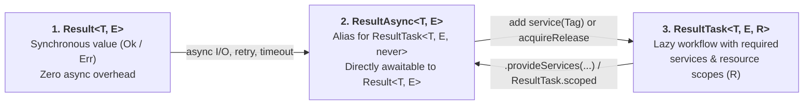

# Resultar

**Typed, composable error handling and resilient workflows for TypeScript — from a single `Result<T, E>` to lazy, dependency-injected `ResultTask<T, E, R>`.**

[](https://nodejs.org)
[](https://github.com/inaiat/resultar/blob/main/packages/resultar/package.json)
[](https://github.com/inaiat/resultar/blob/main/packages/check/README.md)
[](https://github.com/inaiat/resultar/blob/main/LICENSE)

[Gradual Adoption](https://github.com/inaiat/resultar/blob/main/docs/gradual-adoption.md) · [Full Reference (`DOCUMENTATION.md`)](https://github.com/inaiat/resultar/blob/main/DOCUMENTATION.md) · [`resultar-check` Compiler CLI/LSP](https://github.com/inaiat/resultar/blob/main/packages/check/README.md) · [Benchmarks](https://github.com/inaiat/resultar/blob/main/benchmarks/README.md) · [API Decision Guide](#api-decision-guide)

In standard TypeScript, `throw` and rejected promises are invisible in function signatures. Callers have no way of knowing what can fail—or whether they handled every failure case—without reading the implementation.

Resultar moves expected failures into the type system and gives you a complete toolkit to compose, recover, retry, time out, and exhaustively match them from synchronous domain logic to production async workflows.

---

## Why Resultar in 30 Seconds

### Before: Hidden failures

This signature promises a `number`, but silently throws at runtime:

```ts
const parsePort = (input: string): number => {
  const port = Number(input)
  if (!Number.isInteger(port) || port <= 0) {
    throw new Error(`Invalid port ${input}`) // invisible to TypeScript!
  }
  return port
}
```

### After: Explicit, typed contracts

With Resultar, expected failures are first-class values in the return type:

```ts
import { createTaggedError, ok, type Result } from 'resultar'

class InvalidPortError extends createTaggedError({
  name: 'InvalidPortError',
  message: 'Invalid port $input',
}) {}

const parsePort = (input: string): Result<number, InvalidPortError> => {
  const port = Number(input)
  return Number.isInteger(port) && port > 0 ? ok(port) : InvalidPortError.err({ input })
}
```

### End-to-End: Compose linearly, handle exhaustively

Write linear workflows without nested `try/catch` blocks. TypeScript automatically infers the combined error union across every `yield*` step and enforces exhaustive handling at your application boundary:

```ts
import { createTaggedError, ok, Result, tryResultAsync } from 'resultar'

// 1. Define real Error subclasses with typed template props ($email, $operation)
class InvalidEmailError extends createTaggedError({
  name: 'InvalidEmailError',
  message: 'Invalid email $email',
}) {}

class AccountExistsError extends createTaggedError({
  name: 'AccountExistsError',
  message: 'Account $email already exists',
}) {}

class DatabaseError extends createTaggedError({
  name: 'DatabaseError',
  message: 'Database $operation failed',
}) {}

// 2. Write domain & infrastructure steps with explicit error channels
const normalizeEmail = (raw: string): Result<string, InvalidEmailError> => {
  const email = raw.trim().toLowerCase()
  return email.includes('@') ? ok(email) : InvalidEmailError.err({ email })
}

const registerAccount = (input: string) =>
  Result.gen(async function* () {
    const email = yield* normalizeEmail(input)

    if (email === 'taken@example.com') {
      return yield* AccountExistsError.err({ email })
    }

    return yield* tryResultAsync(
      () => db.accounts.insert({ email }),
      (cause) => new DatabaseError({ cause, operation: 'insert-account' }),
    )
  })
// Inferred return type:
// ResultAsync<Account, InvalidEmailError | AccountExistsError | DatabaseError>

// 3. Handle every possible error at the HTTP boundary (compile error if a tag is missed!)
const result = await registerAccount(req.body.email)
const response = result.matchTags(
  (account) => ({ status: 201, body: account }),
  {
    InvalidEmailError: (err) => ({ status: 400, body: { code: err._tag, message: err.message } }),
    AccountExistsError: (err) => ({ status: 409, body: { code: err._tag, message: err.message } }),
    DatabaseError: (err) => ({ status: 503, body: { code: err._tag, message: err.message } }),
  },
)
```

---

## Highlights & Positioning

| What you need | What Resultar provides |
| --- | --- |
| **Expected failures in the type system** | `Result<T, E>` (sync) and `ResultTask<T, E, R>` / `ResultAsync<T, E>` (unified lazy & awaitable async workflows) |
| **Structured production errors** | Real `Error` subclasses via `createTaggedError` with `$prop` interpolation, `cause`, fingerprints, and secret redaction |
| **Linear code without `try/catch`** | `Result.gen` / `Result.fn` and `ResultTask.gen` / `ResultTask.fn` using `yield*` short-circuiting |
| **Exhaustive boundary handling** | `matchTags`, `catchTag`, `catchTags`, and general-purpose `Match` pattern matching |
| **Production async resilience** | Built-in `timeout`, `retry` (with portable `Retry.policy`), `race`, bounded `forEach`, and resource cleanup |
| **Lazy tasks & typed dependencies** | `ResultTask<T, E, R>` with typed service requirements (`R`), `AbortSignal` cancellation, and LIFO resource scopes |
| **Compiler guardrails** | Optional native [`resultar-check`](https://github.com/inaiat/resultar/blob/main/packages/check/README.md) CLI & LSP to forbid ignored results (`noDiscard`) and raw `throw` |

### Where Resultar Sits Between `neverthrow` and `Effect`

Resultar began as a fork of `neverthrow`. It keeps the approachable `Ok` / `Err` mental model while adding structured concurrency, scoped resources, typed DI, and native compiler diagnostics—without forcing a global runtime on your codebase:

| Capability | `neverthrow` | `Resultar` | `Effect` |
| --- | --- | --- | --- |
| **Adoption unit** | 1 function (`Result<T, E>`) | **1 function (`Result<T, E>`)** | Full `Effect<A, E, R>` ecosystem |
| **Direct `await` on async results** | Yes (`ResultAsync<T, E>`) | **Yes (`ResultAsync<T, E>` when `R = never`)** | No (requires `Effect.runPromise` / runtime) |
| **Tagged `Error` classes & secret redaction** | Manual | **Built-in (`createTaggedError`, `redact`)** | Built-in (`Data.TaggedError`, `Redacted`) |
| **Retries, timeouts, races & virtual clock** | Manual | **Built-in (`Retry.policy`, `timeout`, `Clock.virtual`)** | Built-in (`Schedule`, `TestClock`) |
| **Typed DI (`R`), LIFO resource scopes & fibers** | No | **Opt-in via `ResultTask<T, E, R>` & `resultar-di`** | Always present (`Effect<A, E, R>`, `Layer`, `Scope`) |
| **Compiler enforcement (`noDiscard`)** | ESLint plugin | **Native TypeScript-Go CLI & LSP (`resultar-check`)** | Language service plugin |

---

## Install

```sh
pnpm add resultar
# or
npm install resultar
```

- **Runtime**: Node.js 24+, ESM-only (`import { ok, Result } from 'resultar'`)
- **JSR**: Also available as [`@inaiat/resultar`](https://jsr.io/@inaiat/resultar)
- **Diagnostics (optional)**: `pnpm add -D resultar-check` (requires TypeScript 7+)

---

## Adopt Gradually: Three Primitives, One Mental Model

You do not need to rewrite your application to use Resultar. Start with a single function returning `Result<T, E>` and scale up only when a workflow needs async I/O or typed dependencies:



- **`T`** is the success value.
- **`E`** is the expected failure type.
- **`R`** is the typed service environment or resource scope required before a `ResultTask` can run (`never` when no external requirements remain).

`ResultAsync<T, E>` is a type and runtime alias for `ResultTask<T, E, never>`. When `R` is `never`, the task can be `await`ed directly to produce `Result<T, E>`. When `R` contains pending service or scope requirements, TypeScript prevents direct `await` until you satisfy `R` (via `.provide*`, `ResultTask.scoped`, or `ResultTask.runResult(task, { services })`).

| Stage | When to use it | Key APIs |
| --- | --- | --- |
| **1. `Result<T, E>`** | Synchronous validation, parsing, and domain rules | `ok`, `err`, `map`, `andThen`, `Result.gen`, `match` |
| **2. `ResultAsync<T, E>`** | Requirement-free async workflows (`R = never`) that can be `await`ed directly | `tryResultAsync`, `asyncAndThen`, `ResultAsync.retry`, `timeout` |
| **3. `ResultTask<T, E, R>`** | Workflows with typed service injection (`R`), cooperative cancellation, and scoped resource lifecycles | `ResultTask.gen`, `ResultTask.fn`, `tryPromise`, `service`, `acquireRelease`, `runResult` |

### Sync-First, Pay-As-You-Go Execution Engine

All three primitives share a single **sync-first, pay-as-you-go engine** designed so that gradual adoption never imposes unnecessary runtime overhead:

- **Seamless `yield*` interop**: Inside `Result.gen(async function* () { ... })` or `ResultTask.gen(function* () { ... })`, you can `yield*` both `Result` and `ResultAsync` / `ResultTask`. Satisfying all `R` requirements on a `ResultTask<T, E, R>` automatically narrows it back to `ResultAsync<T, E>` (`R = never`).
- **Zero-microtask synchronous fast path**: `Result.gen`, synchronous `ResultTask` pipelines, and `ResultTask.scoped` workflows without async steps execute inside a tight synchronous `while` loop (`runTaskLoop` / `#runGen`) without scheduling microtasks—reusing static singletons (`sharedSuccessExit`, `idleTaskIterator`, `idleRunContext`) on the happy path until a real `Promise` or opt-in `yieldEvery` checkpoint is encountered.
- **Pay only for the stage you use**: Service maps, LIFO finalizer stacks, and fiber schedulers are allocated lazily only when a workflow invokes `service()`, `acquireRelease()`, or `forkChild()`.

See the [Gradual Adoption Guide](https://github.com/inaiat/resultar/blob/main/docs/gradual-adoption.md) for a step-by-step walkthrough and the [Benchmarks Guide](https://github.com/inaiat/resultar/blob/main/benchmarks/README.md) for the architectural and runtime profile.

---

## Contents

- [Tagged Errors (`createTaggedError`)](#tagged-errors)
- [Synchronous Workflows (`Result`)](#synchronous-workflows)
- [Linear Workflows (`Result.gen` & `Result.fn`)](#linear-workflows-with-resultgen)
- [Recovering & Handling Boundaries](#recover-and-handle-results-at-boundaries)
- [Async Work & Resilience (`ResultAsync`)](#async-work-and-resilience)
- [Lazy Workflows (`ResultTask`)](#lazy-workflows-with-resulttask)
  - [Parameterized tasks and tagged recovery](#parameterized-tasks-and-tagged-recovery)
  - [Resource scopes and application lifecycle](#resource-scopes-and-application-lifecycle)
  - [Task concurrency and resilience](#task-concurrency-and-resilience)
  - [Portable retry policies](#portable-retry-policies)
  - [Inspect failure causes](#inspect-failure-causes)
- [Pattern Matching (`Match`)](#pattern-matching-with-match)
- [Prevent Ignored Results (`resultar-check`)](#prevent-ignored-results)
- [Ecosystem Packages (HTTP, Validation, DI)](#ecosystem-packages)
- [API Decision Guide](#api-decision-guide)
- [More Documentation & Limitations](#more-documentation)

---

## Tagged Errors

`createTaggedError` builds real `Error` subclasses with a stable `_tag` discriminant, automatic `$variable` message interpolation, and structured serialization:

```ts
import { createTaggedError } from 'resultar'

class AccountAlreadyExistsError extends createTaggedError({
  name: 'AccountAlreadyExistsError',
  message: 'Account $email already exists',
}) {}

const error = new AccountAlreadyExistsError({ email: 'ada@example.com' })

error instanceof Error                      // true
error instanceof AccountAlreadyExistsError  // true
error._tag                                  // 'AccountAlreadyExistsError'
error.message                               // 'Account ada@example.com already exists'
error.email                                 // 'ada@example.com'
error.fingerprint                           // 'AccountAlreadyExistsError:Account $email already exists'
error.toJSON()                              // cycle-safe serializable object
```

Every tagged error class includes static helpers to construct failures directly without `new`:

```ts
AccountAlreadyExistsError.err({ email })      // Err<never, AccountAlreadyExistsError>
AccountAlreadyExistsError.errAsync({ email }) // ResultAsync<never, AccountAlreadyExistsError>
AccountAlreadyExistsError.taskErr({ email })  // ResultTask<never, AccountAlreadyExistsError>
AccountAlreadyExistsError.is(unknownValue)    // nominal type guard
```

### Refining metadata types with `.withProps()`

Template variables default to `string | number`. Chain `.withProps<...>()` to refine template property types or require additional structured metadata:

```ts
class UserNotFoundError extends createTaggedError({
  name: 'UserNotFoundError',
  message: 'User $id was not found',
}).withProps<{ id: string; details?: { source: string } }>() {}

const missing = new UserNotFoundError({ id: 'user_1', details: { source: 'replica' } })
```

### Preserving causes and redacting secrets

Pass `cause` to preserve the underlying exception chain and inspect it with `.findCause(ErrorClass)`. Wrap sensitive fields in `redact(value, label)` so secrets never leak into `.message` or `.toJSON()` logs:

```ts
import { createTaggedError, isRedacted, redact, revealRedacted } from 'resultar'

class TokenRejectedError extends createTaggedError({
  name: 'TokenRejectedError',
  message: 'Token $token was rejected',
}) {}

const error = new TokenRejectedError({
  token: redact('sk_live_secret', 'api-token'),
  cause: new Error('signature mismatch'),
})

error.message // 'Token <redacted:api-token> was rejected'

if (isRedacted(error.token)) {
  revealRedacted(error.token) // 'sk_live_secret' (explicit access for authorized code)
}
```

> Need lightweight tagged variants or nested error reasons without full `Error` stack traces? Use `taggedEnum` — see the [Tagged Enums guide](https://github.com/inaiat/resultar/blob/main/DOCUMENTATION.md#tagged-enums).

---

## Synchronous Workflows

### Creating Results

In addition to `ok(value)` and `err(error)`, Resultar provides helpers to lift nullable values, predicates, and throwing functions into `Result`:

```ts
import { ok, pipe, Result, tryResult } from 'resultar'

// Reject null or undefined (preserves 0, false, and "")
const envName = Result.fromNullishOr(process.env.USER_NAME, () => 'missing-name' as const)

// Narrow or validate with a predicate (direct or curried in pipe)
const positivePort = pipe(
  3000,
  Result.liftPredicate(
    (n: number) => n > 0,
    (n) => `invalid port: ${n}` as const,
  ),
)

// Wrap synchronous code that might throw
const parsedJson = tryResult(
  () => JSON.parse(rawInput) as Record<string, unknown>,
  (cause) => new InvalidJsonError({ cause }),
)
```

### Chaining and transforming

Success (`Ok`) and failure (`Err`) travel on separate channels:

```ts
const accountEmail = normalizeEmail(input)
  .filterOrElse(
    (email) => email.endsWith('@company.com'),
    (email) => new UnsupportedDomainError({ domain: email.split('@')[1] ?? 'unknown' }),
  )
  .andThen(ensureAccountIsAvailable)              // runs only on Ok; merges error unions
  .map((email) => ({ id: 'acct_1', email }))      // transforms Ok value
  .inspect((acct) => logger.info(acct.id))        // best-effort side effect on Ok
  .mapErr((cause) => new AccountError({ cause })) // transforms Err value
```

### Functional pipelines (`pipe`, `flow`, `identity`, `constant`)

Every operator on `Result`, `ResultAsync`, and `ResultTask` supports both fluent method syntax and curried data-last functions inside `pipe` and `flow`:

```ts
import { constant, flow, identity, pipe, Result } from 'resultar'

const sanitize = flow(
  (input: string) => input.trim(),
  (input) => input.toLowerCase(),
)

const label = pipe(
  '  ADA@COMPANY.COM  ',
  sanitize,
  normalizeEmail,
  Result.map((email) => `User: ${email}`),
  Result.match({ ok: identity, err: constant('Invalid user') }),
)
```

---

## Linear Workflows With `Result.gen`

When a workflow has multiple dependent steps, `Result.gen` lets you write straightforward top-to-bottom code. `yield*` unwraps `Ok` values and immediately short-circuits on the first `Err`:

```ts
import { Result, type ResultAsync } from 'resultar'

const createAccount = (
  input: string,
): ResultAsync<Account, InvalidEmailError | AccountExistsError | DatabaseError> =>
  Result.gen(async function* () {
    const email = yield* normalizeEmail(input)
    yield* ensureAccountIsAvailable(email)

    const account = yield* persistAccount(email)
    return account // plain return value is automatically wrapped in Ok(account)
  })
```

- **Sync vs. Async**: Pass a sync `function*` to get a `Result<T, E>`, or an `async function*` to get a `ResultAsync<T, E>`.
- **Final fallible step**: Use `return yield* step()` or `return yield* MyError.err(...)` so its error channel is tracked.
- **Reusable parameterized functions (`Result.fn`)**: Wrap a generator function and optionally attach post-body pipeline operators (which receive `(result, ...args)`):

```ts
const getOrCreateAccount = Result.fn(
  async function* (input: string) {
    const email = yield* normalizeEmail(input)
    yield* ensureAccountIsAvailable(email)
    return yield* persistAccount(email)
  },
  ResultAsync.catchTag('AccountExistsError', (err) => findAccountByEmail(String(err.email))),
)
```

---

## Recover And Handle Results At Boundaries

### Local recovery inside a workflow

Use `catchTag` or `catchTags` to recover from specific tagged errors while leaving remaining error types untouched in the union:

```ts
// Recover a single tag; InvalidEmailError and DatabaseError stay in the error type
const account = createAccount(input).catchTag('AccountExistsError', (error) =>
  findAccountByEmail(String(error.email)),
)

// Or recover multiple tags at once
const accountOrDraft = createAccount(input).catchTags({
  AccountExistsError: (error) => findAccountByEmail(String(error.email)),
  InvalidEmailError: (error) => ok({ id: 'draft', email: String(error.email) }),
})
```

Use `orElse` when recovering from the entire error channel, or `orElseSucceed` / `unwrapOr` to fall back to a plain default value.

### Exhaustive handling at application boundaries

At the edge of your application (HTTP controllers, CLI commands, queue consumers), turn the `Result` into a final response:

- **`matchTags(onOk, handlers)`**: Requires a handler for every `_tag` in `E`. If a deeper layer adds a new error type, TypeScript flags the boundary at compile time.
- **`matchTagsPartial(onOk, handlers, onUnhandled)`**: Handle specific tags and route the rest to a fallback.
- **`match(onOk, onErr)` / `match({ ok, err })`**: Handle `Ok` and `Err` directly when individual tags don't matter.

> On `Result<T, E>`, `match`, `matchTags`, `matchTagsPartial`, and `unwrapOr` return the unwrapped output value `Out` directly. On `ResultAsync<T, E>` / `ResultTask<T, E, R>`, they remain lazy task operators returning `ResultTask<Out, never, R>` (which resolves to `Ok(Out)` when awaited, or `Out` when executed via `ResultTask.runPromise` / `.unwrapOrThrow()`). At an async boundary, you can either `await` the task first (`(await task).matchTags(...)`) or chain `.matchTags(...).unwrapOrThrow()`.

### Strict Error-only boundaries (`StrictResult`)

While `Result<T, E>` allows any error type (strings or literals are handy in small local helpers), production boundaries usually require real `Error` instances with stack traces and causes. Use the type aliases `StrictResult<T, E extends Error>` and `StrictResultAsync<T, E extends Error>` to enforce `Error` subtypes on public signatures.

---

## Async Work And Resilience

`ResultAsync<T, E>` is a requirement-free `ResultTask<T, E, never>` that implements `PromiseLike<Result<T, E>>`, so you can `await` it directly in any `async` function to get `Result<T, E>`.

### Wrapping external async boundaries

| External boundary | Helper |
| --- | --- |
| Wrap an async/promise factory (catches sync throws too) | `tryResultAsync(factory, toError)` |
| Adapt an already-created Promise | `fromPromise(promise, toError)` |
| Wrap an async function into a reusable `ResultAsync` function | `fromThrowableAsync(fn, toError)` |
| Adapt a callback or event subscription | `ResultAsync.fromCallback(options)` |

### Built-in production resilience

`ResultAsync` models timeouts, retries, races, bounded concurrency, and resource cleanup directly in the expected error channel `E`—no unhandled promise rejections:

```ts
import { ResultAsync } from 'resultar'

// 1. Timeout with cooperative AbortSignal
const timedAccount = ResultAsync.timeout(
  (signal) => loadAccount(accountId, { signal }),
  {
    timeoutMs: 1_500,
    onTimeout: () => new AccountTimeoutError({ accountId, timeoutMs: 1_500 }),
  },
)

// 2. Retry transient failures with backoff, jitter, and fallback
const retriedAccount = ResultAsync.retryOrElse(
  (attempt, signal) => loadAccount(accountId, { attempt, signal }),
  {
    times: 2,
    delayMs: ({ nextAttempt }) => nextAttempt * 100,
    jittered: 0.2,
    while: (error) => error._tag === 'DatabaseBusyError',
    orElse: () => loadCachedAccount(accountId),
  },
)

// 3. Race redundant providers (returns first Ok, aborts losers)
const fastestAccount = ResultAsync.race(
  (signal) => loadFromPrimary(accountId, { signal }),
  (signal) => loadFromReplica(accountId, { signal }),
)

// 4. Bounded concurrency over collections
const imported = ResultAsync.forEach(
  users,
  (user) => provisionAccount(user.email),
  { concurrency: 8 }, // or validateAll(...) to collect all errors
)

// 5. Acquire-use-release bracket
const inserted = ResultAsync.withResource({
  acquire: (signal) => dbPool.connect({ signal }),
  use: (conn, signal) => conn.insertAccount(input, { signal }),
  release: (conn) => conn.close(),
})
```

---

## Lazy Workflows With ResultTask

`ResultTask<T, E, R>` is Resultar's unified async and workflow primitive (with `ResultAsync<T, E>` as its `R = never` specialization). A `ResultTask` is an immutable, reusable blueprint that only executes when `await`ed (when `R = never`) or passed to a `run*` boundary:

```ts
import { ResultTask } from 'resultar'

const fetchUser = (id: string) =>
  ResultTask.tryPromise({
    try: (signal) => fetch(`/api/users/${id}`, { signal }).then((res) => res.json()),
    catch: (cause) => new UserLoadError({ cause, id }),
  })

const task = fetchUser('user_123') // Nothing has executed yet!

// Execute explicitly at your application boundary (or `await task` when R = never):
const result = await ResultTask.runResult(task)
```

| Execution boundary | Return type | When to use |
| --- | --- | --- |
| `await task` (when `R = never`) | `Promise<Result<T, E>>` | Ergonomic boundary for requirement-free tasks (`ResultAsync<T, E>`) |
| `ResultTask.runResult(task, options?)` | `Promise<Result<T, E>>` | Standard boundary with runtime options (`services`, `signal`, `clock`, `scheduler`) |
| `ResultTask.runExit(task, options?)` | `Promise<Exit<T, E>>` | Total boundary: never rejects; captures typed `Fail`, unexpected `Die` defects, `Interrupt`, and `Sequential`/`Parallel` causes |
| `ResultTask.runPromise(task, options?)` | `Promise<T>` | Promise-only interop: resolves `T` or rejects any failure |
| `ResultTask.runFork(task, options?)` | `FiberHandle<T, E>` | Background execution: starts a root fiber with `.id`, `Fiber.poll`, `Fiber.await`, and `Fiber.interrupt` |

### Parameterized tasks and tagged recovery

Declare typed service requirements with `ResultTask.service<Contract>()('Tag')` and compose lazy workflows with `ResultTask.gen` or `ResultTask.fn`. If a required service is missing at `runResult` (or if you try to `await` a task before providing `R`), TypeScript reports a compile-time error:

```ts
import { createTaggedError, ok, ResultTask } from 'resultar'

class UserNotFoundError extends createTaggedError({
  name: 'UserNotFoundError',
  message: 'User $id was not found',
}) {}

const UsersRepo = ResultTask.service<{
  findById(id: string): ResultTask<{ id: string; name: string }, UserNotFoundError>
}>()('UsersRepo')

// ResultTask.fn wraps a generator and applies post-body operators lazily per call
const loadUserDisplayName = ResultTask.fn(
  function* (id: string) {
    const repo = yield* UsersRepo
    const user = yield* repo.findById(id)
    return user.name
  },
  ResultTask.catchTag('UserNotFoundError', (err) => ok(`Guest (${err.id})`)),
)
// Type: (id: string) => ResultTask<string, never, Service<'UsersRepo', ...>>

// Provide services at the boundary (or ahead of time via ResultTask.provideServices)
const nameResult = await ResultTask.runResult(loadUserDisplayName('u_42'), {
  services: {
    UsersRepo: {
      findById: (id) => UserNotFoundError.taskErr({ id }),
    },
  },
})
```

### Resource scopes and application lifecycle

Use `ResultTask.acquireRelease` (or `ResultTask.acquireDisposable` for native `Disposable` / `AsyncDisposable` objects) to tie resource cleanup to a scope. Finalizers always run in reverse acquisition order (LIFO)—even when the workflow fails, throws a defect, or is interrupted:

```ts
const dbResource = ResultTask.acquireRelease({
  acquire: ResultTask.tryPromise({
    try: (signal) => connectDatabase(signal),
    catch: (cause) => new ConnectionError({ cause }),
  }),
  release: (db, exit) =>
    ResultTask.tryPromise({
      try: () => db.close(exit),
      catch: (cause) => new CloseError({ cause }),
    }),
})

const queryProgram = ResultTask.scoped(
  ResultTask.gen(function* () {
    const db = yield* dbResource
    return yield* ResultTask.tryPromise({
      try: (signal) => db.query('SELECT 1', signal),
      catch: (cause) => new QueryError({ cause }),
    })
  }),
)
```

`acquireRelease` tracks any release error in `R` (`ResultTaskScope<CloseError>`) so inner `orElse` calls cannot accidentally swallow a pending finalizer failure before `ResultTask.scoped` (or a `run*` boundary) closes the scope.

### Task concurrency and resilience

`ResultTask` pipelines share the active `AbortSignal`, `Clock`, and resource scope across retries, timeouts, races, bounded collections, and child fibers:

```ts
import { Clock, Fiber, ResultTask } from 'resultar'

const resilientTask = fetchUser('user_123')
  .retry({ times: 2, delayMs: 100, backoff: 2, jittered: true })
  .timeout(2_000, () => new UserTimeoutError())

// Deterministic testing with a virtual clock (no real timers):
const clock = Clock.virtual()
const pending = ResultTask.runResult(resilientTask, { clock })
await clock.advanceBy(2_000)
const outcome = await pending
```

- **Collections & concurrency limits**: `ResultTask.all`, `ResultTask.forEach`, and `ResultTask.validateAll` run sequentially by default or concurrently via `{ concurrency: 8 | 'unbounded' }`. Use `ResultTask.makeSemaphore(permits)` to limit concurrency across independent tasks.
- **Structured child fibers**: `yield* ResultTask.forkChild(task)` starts background work attached to the current scope. Join or cancel it with `Fiber.join(fiber)`, `Fiber.await(fiber)`, or `Fiber.interrupt(fiber)`.

### Portable retry policies

Share a single, immutable retry configuration across both `ResultTask` and `ResultAsync` call styles with `Retry.policy`:

```ts
import { Retry } from 'resultar'

const transientPolicy = Retry.policy({
  times: 3,
  delayMs: 100,
  backoff: 2,
  jittered: 0.2,
})

const taskWithRetry = fetchUser('user_123').retry(transientPolicy)
const asyncWithRetry = ResultAsync.retry((attempt, signal) => loadAsync(signal), transientPolicy)
```

### Inspect failure causes

When executing a task with `ResultTask.runExit(task)`, failures are represented as a `Cause<E>` tree (`Fail`, `Die`, `Interrupt`, `Sequential`, or `Parallel`). Use the `Cause` namespace to inspect or format them:

```ts
import { Cause, ResultTask } from 'resultar'

const exit = await ResultTask.runExit(queryProgram)

if (exit._tag === 'Failure') {
  Cause.failures(exit.cause) // E[] — all expected typed errors in order
  Cause.defects(exit.cause)  // unknown[] — all unexpected Die defects
  Cause.pretty(exit.cause)   // human-readable diagnostic trace with stacks & redaction
}
```

> For advanced `ResultTask` details—including `interruption: 'detach'`, custom `Scheduler` instruction budgets, `provideServiceResolver`, and `catchCause` / `sandbox`—see the [Full Resultar Guide](https://github.com/inaiat/resultar/blob/main/DOCUMENTATION.md#lazy-tasks-and-service-requirements).

---

## Pattern Matching With Match

`Match` brings exhaustive, type-narrowing pattern matching to ordinary TypeScript unions, domain events, and HTTP route error mappers. Tag and discriminator tables compile into $O(1)$ lookup tables:

```ts
import { Match } from 'resultar'

type DomainEvent =
  | { _tag: 'UserCreated'; id: string }
  | { _tag: 'UserDeleted'; count: number }

// Build a reusable matcher function
const describeEvent = Match.type<DomainEvent>()
  .tag('UserCreated', (event) => `Created ${event.id}`)
  .tag('UserDeleted', (event) => `Deleted ${event.count} records`)
  .exhaustive()

// Or match a value immediately by tag
const summary = Match.valueTags(event, {
  UserCreated: (e) => e.id,
  UserDeleted: (e) => String(e.count),
})
```

### Reusable HTTP error handlers with `Match.context`

When multiple Hono or Fastify routes share the same error-to-HTTP mapping, extract a context-aware matcher:

```ts
import type { Context } from 'hono'
import { Match } from 'resultar'

const respondError = Match.context<
  UserNotFoundError | DatabaseError,
  [c: Context]
>().tagsExhaustive({
  UserNotFoundError: (err, c) => c.json({ error: err.message }, 404),
  DatabaseError: (_err, c) => c.json({ error: 'Service unavailable' }, 503),
})

// Inside a route handler:
const result = await users.findById(id)
return result.match({
  ok: (user) => c.json(user, 200),
  err: (error) => respondError(error, c),
})
```

| Pattern need | `Match` API |
| --- | --- |
| Match literals, shapes, predicates, or built-in guards (`Match.string`, `Match.number`, `Match.defined`, `Match.instanceOf`, etc.) | `when`, `whenOr`, `whenAnd`, `not` |
| Match `_tag` unions | `tag`, `tags`, `tagsExhaustive`, `valueTags`, `typeTags` |
| Match custom discriminant fields or prefixes | `discriminator`, `discriminatorsExhaustive`, `tagStartsWith` |
| Finalize matcher | `exhaustive`, `orElse`, `result` (`Result<Matched, Remaining>`), `option` |

---

## Prevent Ignored Results

A `Result` only protects your application if callers actually handle it. Install [`resultar-check`](https://github.com/inaiat/resultar/blob/main/packages/check/README.md)—a native TypeScript-Go CLI and LSP server that runs compiler typechecks and Resultar-specific rules in a single pass:

```sh
pnpm add -D resultar-check
```

Add the rule configuration to `tsconfig.json`:

```json
{
  "$schema": "./node_modules/resultar-check/schema.json",
  "compilerOptions": {
    "plugins": [
      {
        "name": "resultar-check",
        "noDiscard": "error"
      }
    ]
  }
}
```

Run `resultar-check` in CI or `resultar-check lsp` in your editor to catch discarded `Result` / `ResultAsync` / `ResultTask` values, unprovided `any` task requirements, raw `throw` statements (`noThrow`), and ad-hoc `try/catch` blocks (`noTryCatch`). See the [`resultar-check` README](https://github.com/inaiat/resultar/blob/main/packages/check/README.md) for all rules and editor setup.

---

## Ecosystem Packages

Resultar's companion packages integrate directly with the core primitives:

| Package | When to use it | Documentation |
| --- | --- | --- |
| [`resultar-check`](https://www.npmjs.com/package/resultar-check) | Native TypeScript-Go compiler + Resultar linter & LSP | [README](https://github.com/inaiat/resultar/blob/main/packages/check/README.md) |
| [`resultar-request`](https://www.npmjs.com/package/resultar-request) | Fetch-first JSON HTTP client returning `ResultAsync` with retries & typed errors | [README](https://github.com/inaiat/resultar/blob/main/packages/request/README.md) |
| [`resultar-request-zod`](https://www.npmjs.com/package/resultar-request-zod) | Zod schema validation adapter for `resultar-request` | [README](https://github.com/inaiat/resultar/blob/main/packages/request-zod/README.md) |
| [`resultar-request-typebox`](https://www.npmjs.com/package/resultar-request-typebox) | TypeBox schema validation adapter for `resultar-request` | [README](https://github.com/inaiat/resultar/blob/main/packages/request-typebox/README.md) |
| [`resultar-di`](https://www.npmjs.com/package/resultar-di) | Typed dependency injection, class services, and scoped resources for `ResultTask` | [README](https://github.com/inaiat/resultar/blob/main/packages/di/README.md) |
| [`resultar-hono`](https://www.npmjs.com/package/resultar-hono) | Hono integration with per-request DI scopes and graceful shutdown | [README](https://github.com/inaiat/resultar/blob/main/packages/hono/README.md) |
| [`resultar-fastify`](https://www.npmjs.com/package/resultar-fastify) | Fastify plugin with application/request DI scopes and lifecycle cleanup | [README](https://github.com/inaiat/resultar/blob/main/packages/fastify/README.md) |

---

## API Decision Guide

| Goal | Recommended API |
| --- | --- |
| Create success or failure | `ok`, `err`, `okAsync`, `errAsync`, `unit`, `unitAsync` |
| Define a structured error class | `createTaggedError({ name, message })` (`.withProps<...>()` for custom field types) |
| Lift nullable values or predicates | `Result.fromNullishOr`, `Result.liftPredicate` |
| Wrap throwing sync or async code | `tryResult`, `fromThrowable`, `tryResultAsync`, `fromPromise`, `fromThrowableAsync` |
| Transform or chain results | `map`, `mapErr`, `andThen`, `asyncAndThen`, `filterOrElse`, `as`, `asVoid` |
| Write linear generator workflows | `Result.gen`, `Result.fn`, `ResultTask.gen`, `ResultTask.fn` |
| Recover from specific errors | `catchTag`, `catchTags`, `orElse`, `orElseSucceed`, `unwrapOr` |
| Handle results at a boundary | `matchTags`, `matchTagsPartial`, `match` |
| Combine multiple results | `Result.all`, `zip`, `validateAll`, `firstSuccessOf` |
| Add async timeout, retry, or race | `ResultAsync.timeout`, `retry`, `retryOrElse`, `race`, `raceAll`, `Retry.policy` |
| Build lazy, cancelable workflows | `ResultTask.tryPromise`, `sync`, `try`, `service`, `provideServices` |
| Manage resource lifecycles | `ResultTask.acquireRelease`, `acquireDisposable`, `scoped`, `ensuring`, `ResultAsync.withResource` |
| Run lazy tasks at an edge | `ResultTask.runResult`, `runExit`, `runPromise`, `runFork` |
| Observe without altering the channel | `inspect`, `inspectError`, `inspectBoth`, `log` |

See the [Complete API Map](https://github.com/inaiat/resultar/blob/main/DOCUMENTATION.md#api-map) for all overloads, collection helpers, and compatibility aliases.

---

## Coding Agents

Every npm release bundles `dist/llms.txt`, `dist/agent/SKILL.md`, focused API and service references, and a compiled workflow example inside `node_modules/resultar/dist/agent/`. Point your coding agent to those installed files so its guidance always matches the exact installed version.

---

## More Documentation

- [Gradual Adoption: `Result` to `ResultTask`](https://github.com/inaiat/resultar/blob/main/docs/gradual-adoption.md)
- [Full Resultar Reference (`DOCUMENTATION.md`)](https://github.com/inaiat/resultar/blob/main/DOCUMENTATION.md)
- [v4 Migration & Deprecated API Notes](https://github.com/inaiat/resultar/blob/main/docs/migrations/v4.md)
- [Runnable Examples (`examples/`)](https://github.com/inaiat/resultar/tree/main/examples)
- [Type-Safe Error Handling Article (EN)](https://github.com/inaiat/resultar/blob/main/articles/en/type-safe.md) | [Artigo em Português (PT-BR)](https://github.com/inaiat/resultar/blob/main/articles/pt/type-safe.md)

### Scope & Limitations

- **Focused scope**: Resultar is not a full Effect port—it intentionally omits `Stream`, STM, distributed clustering, and a global application runtime.
- **Cooperative cancellation**: `ResultTask` / `ResultAsync` timeouts and fiber interruptions abort the `AbortSignal` and await scope finalizers; underlying I/O drivers must respect the signal (or opt into `interruption: 'detach'`).
- **Deferred execution vs. already-started Promises**: `ResultTask` and `ResultAsync` factories (`tryPromise`, `tryResultAsync`, `Result.gen`, `ResultTask.gen`) defer execution until `await`ed or passed to `ResultTask.run*`. Wrapping an already-created `Promise` with `fromPromise` or `fromSafePromise` cannot defer or retry work that has already started.

## License

MIT
