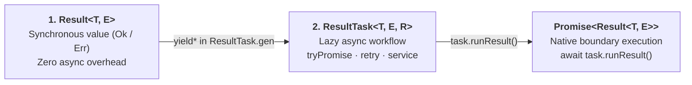

# Resultar

**Typed, composable error handling and resilient workflows for TypeScript — from a single `Result<T, E>` to lazy, dependency-injected `ResultTask<T, E, R>`.**

[](https://nodejs.org)
[](https://github.com/inaiat/resultar/blob/main/packages/resultar/package.json)
[](https://inaiat.github.io/resultar/#/docs/resultar-check)
[](https://github.com/inaiat/resultar/blob/main/LICENSE)

[Documentation](https://inaiat.github.io/resultar/) · [Playground](https://inaiat.github.io/resultar/#/playground) · [Coming from Effect](https://inaiat.github.io/resultar/#/docs/coming-from-effect) · [What's New in v5](#whats-new-in-v5) · [v5 Migration](https://inaiat.github.io/resultar/#/docs/v5-migration) · [Gradual Adoption](https://inaiat.github.io/resultar/#/docs/gradual-adoption) · [Complete Guide](https://inaiat.github.io/resultar/#/docs/full-reference) · [`resultar-check` Compiler CLI/LSP](https://inaiat.github.io/resultar/#/docs/resultar-check) · [Benchmarks](https://inaiat.github.io/resultar/#/docs/benchmarks) · [API Decision Guide](#api-decision-guide)

In standard TypeScript, `throw` and rejected promises are invisible in function signatures. Callers have no way of knowing what can fail—or whether they handled every failure case—without reading the implementation.

Resultar moves expected failures into the type system and gives you a complete toolkit to compose, recover, retry, time out, and exhaustively match them from synchronous domain logic to production async workflows.

---

## Why Resultar in 30 Seconds

### Before: Hidden failures

This signature promises a `number`, but silently throws at runtime:

```ts
const parsePort = (input: string): number => {
  const port = Number(input);
  if (!Number.isInteger(port) || port <= 0) {
    throw new Error(`Invalid port ${input}`); // invisible to TypeScript!
  }
  return port;
};
```

### After: Explicit, typed contracts

With Resultar, expected failures are first-class values in the return type:

```ts
import { createTaggedError, ok, type Result } from "resultar";

class InvalidPortError extends createTaggedError({
  name: "InvalidPortError",
  message: "Invalid port $input",
}) {}

const parsePort = (input: string): Result<number, InvalidPortError> => {
  const port = Number(input);
  return Number.isInteger(port) && port > 0 ? ok(port) : InvalidPortError.err({ input });
};
```

### End-to-End: Compose linearly, handle exhaustively

Write linear workflows without nested `try/catch` blocks. TypeScript automatically infers the combined error union across every `yield*` step and enforces exhaustive handling at your application boundary:

```ts
import { createTaggedError, ok, ResultTask, type Result } from "resultar";

// 1. Define real Error subclasses with typed template props ($email, $operation)
class InvalidEmailError extends createTaggedError({
  name: "InvalidEmailError",
  message: "Invalid email $email",
}) {}

class AccountExistsError extends createTaggedError({
  name: "AccountExistsError",
  message: "Account $email already exists",
}) {}

class DatabaseError extends createTaggedError({
  name: "DatabaseError",
  message: "Database $operation failed",
}) {}

// 2. Write domain & infrastructure steps with explicit error channels
const normalizeEmail = (raw: string): Result<string, InvalidEmailError> => {
  const email = raw.trim().toLowerCase();
  return email.includes("@") ? ok(email) : InvalidEmailError.err({ email });
};

const registerAccount = (input: string) =>
  ResultTask.gen(function* () {
    const email = yield* normalizeEmail(input);

    if (email === "taken@example.com") {
      return yield* AccountExistsError.err({ email });
    }

    return yield* ResultTask.tryPromise({
      try: () => db.accounts.insert({ email }),
      catch: (cause) => new DatabaseError({ cause, operation: "insert-account" }),
    });
  });
// Inferred return type:
// ResultTask<Account, InvalidEmailError | AccountExistsError | DatabaseError>

// 3. Handle every possible error at the HTTP boundary (compile error if a tag is missed!)
const result = await registerAccount(req.body.email).runResult();
const response = result.matchTags((account) => ({ status: 201, body: account }), {
  InvalidEmailError: (err) => ({ status: 400, body: { code: err._tag, message: err.message } }),
  AccountExistsError: (err) => ({ status: 409, body: { code: err._tag, message: err.message } }),
  DatabaseError: (err) => ({ status: 503, body: { code: err._tag, message: err.message } }),
});
```

---

## Highlights & Positioning

| What you need                            | What Resultar provides                                                                                                                                                                    |
| ---------------------------------------- | ----------------------------------------------------------------------------------------------------------------------------------------------------------------------------------------- |
| **Expected failures in the type system** | `Result<T, E>` for sync values and `ResultTask<T, E, R>` for lazy async workflows (`task.runResult()` returns native `Promise<Result<T, E>>`), plus opt-in `resultar/async` compatibility |
| **Structured production errors**         | Real `Error` subclasses via `createTaggedError` with `$prop` interpolation, `cause`, fingerprints, and secret redaction                                                                   |
| **Linear code without `try/catch`**      | `Result.gen` / `Result.fn` and `ResultTask.gen` / `ResultTask.fn` using `yield*` short-circuiting                                                                                         |
| **Exhaustive boundary handling**         | `matchTags`, `catchTag`, `catchTags`, and general-purpose `Match` pattern matching                                                                                                        |
| **Production async resilience**          | Built-in `timeout`, `retry` (with portable `Retry.policy`), `race`, bounded `forEach`, and resource cleanup                                                                               |
| **Lazy tasks & typed dependencies**      | `ResultTask<T, E, R>` with typed service requirements (`R`), `AbortSignal` cancellation, and LIFO resource scopes                                                                         |
| **Compiler guardrails**                  | Optional native [`resultar-check`](https://inaiat.github.io/resultar/#/docs/resultar-check) CLI & LSP to forbid ignored results (`noDiscard`) and raw `throw`                             |

### Where Resultar Sits Between `neverthrow` and `Effect`

Resultar began as a fork of `neverthrow`. It keeps the approachable `Ok` / `Err` mental model while adding structured concurrency, scoped resources, typed DI, and native compiler diagnostics—without forcing a global runtime on your codebase:

| Capability                                        | `neverthrow`                | `Resultar`                                                                          | `Effect`                                             |
| ------------------------------------------------- | --------------------------- | ----------------------------------------------------------------------------------- | ---------------------------------------------------- |
| **Adoption unit**                                 | 1 function (`Result<T, E>`) | **1 function (`Result<T, E>`)**                                                     | Full `Effect<A, E, R>` ecosystem                     |
| **Direct `await` on async results**               | Yes (`ResultAsync<T, E>`)   | **Task uses explicit `task.runResult()`, returning native `Promise<Result<T, E>>`** | No (requires `Effect.runPromise` / runtime)          |
| **Tagged `Error` classes & secret redaction**     | Manual                      | **Built-in (`createTaggedError`, `redact`)**                                        | Built-in (`Data.TaggedError`, `Redacted`)            |
| **Retries, timeouts, races & virtual clock**      | Manual                      | **Built-in (`Retry.policy`, `timeout`, `Clock.virtual`)**                           | Built-in (`Schedule`, `TestClock`)                   |
| **Typed DI (`R`), LIFO resource scopes & fibers** | No                          | **Opt-in via `ResultTask<T, E, R>` & `resultar-di`**                                | Always present (`Effect<A, E, R>`, `Layer`, `Scope`) |
| **Compiler enforcement (`noDiscard`)**            | ESLint plugin               | **Native TypeScript-Go CLI & LSP (`resultar-check`)**                               | Language service plugin                              |

---

## Install

```sh
pnpm add resultar
# or
npm install resultar
```

- **Runtime**: Node.js 24+, ESM-only (`import { ok, Result } from 'resultar'`)
- **JSR**: Also available as [`@inaiat/resultar`](https://jsr.io/@inaiat/resultar)
- **Diagnostics (optional)**: `pnpm add -D resultar-check` (requires TypeScript 7+)

---

## What's New in v5

- **Unified async model (`Result` + `ResultTask`)**: Root `"resultar"` exports only `Result<T, E>` (pure synchronous) and `ResultTask<T, E, R>` (lazy async workflows), with zero transitive `ResultAsync` code or type coupling.
- **Native `Promise<Result<T, E>>` from `task.runResult()`**: `task.runResult()` and `ResultTask.runResult(task)` return a native `Promise<Result<T, E | ScopeError<R>>>` directly—no `PromiseLike` quirks, no `Promise.resolve(...)` wrapper needed for `.catch()`, `.finally()`, or `assert.rejects`.
- **Opt-in `@deprecated` `"resultar/async"` subpath**: Legacy eager `ResultAsync` and `StrictResultAsync` constructors (`okAsync`, `errAsync`, `unitAsync`, `fromPromise`, `fromSafePromise`, `tryResultAsync`, `ResultAsync.gen` / `ResultAsync.fn`, standalone `asyncMap` / `asyncAndThen`, `safeTry`, and `@deprecated` v4 `ResultAsync` compatibility helpers such as `fromTask`, `retry`, `withResource`, `fromCallback`, `tap`, and `tapError`) remain available in `"resultar/async"` throughout v5.x for incremental migration while removed from root `"resultar"`.
- **Task-native ecosystem & `resultar-check migrate-v5`**: `resultar-request`, `resultar-request-zod`, and `resultar-request-typebox` return `ResultTask` directly; companion adapters (`resultar-di`, `resultar-hono`, `resultar-fastify`, `resultar-nestjs`) have zero `ResultAsync` dependencies; and `resultar-check` adds `no-await-result-task` (default `"error"`) plus `resultar-check migrate-v5` automated migration.

> Upgrading from v4? Read the full **[v5 Migration Guide](https://inaiat.github.io/resultar/#/docs/v5-migration)** and run `pnpm exec resultar-check migrate-v5`.

---

## Adopt Gradually: Two Primitives, One Mental Model

You do not need to rewrite your application to use Resultar. Start with a single function returning `Result<T, E>` and scale up to `ResultTask<T, E, R>` whenever a workflow needs async I/O, retries, scopes, or typed dependencies:



- **`T`** is the success value.
- **`E`** is the expected failure type.
- **`R`** is the typed service environment or resource scope required before a `ResultTask` can run (`never` when no external requirements remain).

Use `ResultTask` for all asynchronous workflows and run it explicitly, including when
`R = never`. Providing services or closing a scope leaves a Task. Calling `task.runResult()`
(or `ResultTask.runResult(task)`) starts the task and returns a native `Promise<Result<T, E>>`
that you `await` directly at your imperative boundary.
Use `ResultTask.tryPromise({ try, catch })` directly for raw Promise-returning drivers.
New async repositories and use cases return Tasks without an `async` modifier;
native Promise returns belong to explicit runners or framework/SDK boundaries.
See the [boundary decision table](../../DOCUMENTATION.md#promise-boundaries-and-application-contracts).

| Stage                        | When to use it                                                                                 | Key APIs                                                                                  |
| ---------------------------- | ---------------------------------------------------------------------------------------------- | ----------------------------------------------------------------------------------------- |
| **1. `Result<T, E>`**        | Synchronous validation, parsing, and domain rules                                              | `ok`, `err`, `map`, `andThen`, `Result.gen`, `match`                                      |
| **2. `ResultTask<T, E, R>`** | All asynchronous workflows; add typed services, cooperative cancellation, and scopes as needed | `ResultTask.gen`, `ResultTask.fn`, `tryPromise`, `service`, `acquireRelease`, `runResult` |

### Sync-First, Pay-As-You-Go Execution Engine

Result values remain synchronous, and the Task runtime uses synchronous fast paths until an
asynchronous step is needed:

- **Explicit `yield*` interop**: Core `Result.gen` / `Result.fn` are purely synchronous. `ResultTask.gen` / `ResultTask.fn` compose Results, Tasks, and service tags; adapt legacy eager operations with `fromResultAsync`. Satisfying `R` keeps the Task contract.
- **Zero-microtask synchronous fast path**: `Result.gen`, synchronous `ResultTask` pipelines, and `ResultTask.scoped` workflows without async steps execute inside a tight synchronous `while` loop (`runTaskLoop` / `#runGen`) without scheduling microtasks—reusing static singletons (`sharedSuccessExit`, `idleTaskIterator`, `idleRunContext`) on the happy path until a real `Promise` or cooperative `yieldEvery` checkpoint is encountered.
- **Pay only for the stage you use**: Service maps, LIFO finalizer stacks, and fiber schedulers are allocated lazily only when a workflow invokes `service()`, `acquireRelease()`, or `forkChild()`.

See the [Gradual Adoption Guide](https://inaiat.github.io/resultar/#/docs/gradual-adoption) for a step-by-step walkthrough and the [Benchmarks Guide](https://inaiat.github.io/resultar/#/docs/benchmarks) for the architectural and runtime profile.

---

## Contents

- [What's New in v5](#whats-new-in-v5)
- [Tagged Errors (`createTaggedError`)](#tagged-errors)
- [Synchronous Workflows (`Result`)](#synchronous-workflows)
- [Linear Workflows (Result and Task generators)](#linear-workflows-with-result-and-task-generators)
- [Recovering & Handling Boundaries](#recover-and-handle-results-at-boundaries)
- [Lazy Workflows (`ResultTask`)](#lazy-workflows-with-resulttask)
  - [Parameterized tasks and tagged recovery](#parameterized-tasks-and-tagged-recovery)
  - [Resource scopes and application lifecycle](#resource-scopes-and-application-lifecycle)
  - [Task concurrency and resilience](#task-concurrency-and-resilience)
  - [Portable retry policies](#portable-retry-policies)
  - [Inspect failure causes](#inspect-failure-causes)
- [Opt-In Eager Compatibility (`resultar/async`)](#opt-in-eager-compatibility-resultarasync)
- [Pattern Matching (`Match`)](#pattern-matching-with-match)
- [Prevent Ignored Results (`resultar-check`)](#prevent-ignored-results)
- [Ecosystem Packages (HTTP, Validation, DI)](#ecosystem-packages)
- [API Decision Guide](#api-decision-guide)
- [More Documentation & Limitations](#more-documentation)

---

## Tagged Errors

`createTaggedError` builds real `Error` subclasses with a stable `_tag` discriminant, automatic `$variable` message interpolation, and structured serialization:

```ts
import { createTaggedError } from "resultar";

class AccountAlreadyExistsError extends createTaggedError({
  name: "AccountAlreadyExistsError",
  message: "Account $email already exists",
}) {}

const error = new AccountAlreadyExistsError({ email: "ada@example.com" });

error instanceof Error; // true
error instanceof AccountAlreadyExistsError; // true
error._tag; // 'AccountAlreadyExistsError'
error.message; // 'Account ada@example.com already exists'
error.email; // 'ada@example.com'
error.fingerprint; // ["AccountAlreadyExistsError", "Account $email already exists"]
error.toJSON(); // cycle-safe serializable object
```

Every tagged error class includes static helpers to construct failures directly without `new`:

```ts
AccountAlreadyExistsError.err({ email }); // Err<never, AccountAlreadyExistsError>
AccountAlreadyExistsError.taskErr({ email }); // ResultTask<never, AccountAlreadyExistsError>
AccountAlreadyExistsError.is(unknownValue); // nominal type guard
```

### Refining metadata types with `.withProps()`

Template variables default to `string | number | Redacted<unknown>`. Chain `.withProps<...>()` to refine template property types or require additional structured metadata:

```ts
class UserNotFoundError extends createTaggedError({
  name: "UserNotFoundError",
  message: "User $id was not found",
}).withProps<{ id: string; details?: { source: string } }>() {}

const missing = new UserNotFoundError({ id: "user_1", details: { source: "replica" } });
```

### Preserving causes and redacting secrets

Pass `cause` to preserve the underlying exception chain and inspect it with `.findCause(ErrorClass)`. Wrap sensitive fields in `redact(value, label)` so secrets never leak into `.message` or `.toJSON()` logs:

```ts
import { createTaggedError, isRedacted, redact, revealRedacted } from "resultar";

class TokenRejectedError extends createTaggedError({
  name: "TokenRejectedError",
  message: "Token $token was rejected",
}) {}

const error = new TokenRejectedError({
  token: redact("sk_live_secret", "api-token"),
  cause: new Error("signature mismatch"),
});

error.message; // 'Token <redacted:api-token> was rejected'

if (isRedacted(error.token)) {
  revealRedacted(error.token); // 'sk_live_secret' (explicit access for authorized code)
}
```

> **Skipping stack traces on expected hot-path errors:** Pass `captureStackTrace: false` to `createTaggedError({ name, message, captureStackTrace: false })` to avoid V8 stack-frame capture while keeping a real `Error` subclass (`instanceof Error`, `_tag`, `cause`, `fingerprint`, and original `Error.stackTraceLimit`). Need plain tagged variants without `Error` inheritance at all? Use `taggedEnum` — see the [Tagged Enums guide](https://inaiat.github.io/resultar/#/docs/full-reference#tagged-enums).

---

## Synchronous Workflows

### Creating Results

In addition to `ok(value)` and `err(error)`, Resultar provides helpers to lift nullable values, predicates, and throwing functions into `Result`:

```ts
import { ok, pipe, Result, tryResult } from "resultar";

// Reject null or undefined (preserves 0, false, and "")
const envName = Result.fromNullishOr(process.env.USER_NAME, () => "missing-name" as const);

// Narrow or validate with a predicate (direct or curried in pipe)
const positivePort = pipe(
  3000,
  Result.liftPredicate(
    (n: number) => n > 0,
    (n) => `invalid port: ${n}` as const,
  ),
);

// Wrap synchronous code that might throw
const parsedJson = tryResult(
  () => JSON.parse(rawInput) as Record<string, unknown>,
  (cause) => new InvalidJsonError({ cause }),
);
```

### Chaining and transforming

Success (`Ok`) and failure (`Err`) travel on separate channels:

```ts
const accountEmail = normalizeEmail(input)
  .filterOrElse(
    (email) => email.endsWith("@company.com"),
    (email) => new UnsupportedDomainError({ domain: email.split("@")[1] ?? "unknown" }),
  )
  .andThen(ensureAccountIsAvailable) // runs only on Ok; merges error unions
  .map((email) => ({ id: "acct_1", email })) // transforms Ok value
  .inspect((acct) => logger.info(acct.id)) // best-effort side effect on Ok
  .mapErr((cause) => new AccountError({ cause })); // transforms Err value
```

### Functional pipelines (`pipe`, `flow`, `identity`, `constant`)

Result and Task transformations support fluent methods and curried functions inside `pipe`
and `flow`. `ResultAsync` also retains its existing functional forms:

```ts
import { constant, flow, identity, pipe, Result } from "resultar";

const sanitize = flow(
  (input: string) => input.trim(),
  (input) => input.toLowerCase(),
);

const label = pipe(
  "  ADA@COMPANY.COM  ",
  sanitize,
  normalizeEmail,
  Result.map((email) => `User: ${email}`),
  Result.match({ ok: identity, err: constant("Invalid user") }),
);
```

---

<a id="linear-workflows-with-resultgen"></a>

## Linear Workflows With Result And Task Generators

Use `Result.gen` / `Result.fn` for synchronous domain steps, and `ResultTask.gen` /
`ResultTask.fn` for new asynchronous workflows. Both use plain success returns;
`yield*` unwraps successes and short-circuits expected failures.

```ts
import { Result, ResultTask } from "resultar";

const validateAccount = Result.fn(function* (input: string) {
  const email = yield* normalizeEmail(input);
  yield* ensureAccountIsAvailable(email);
  return email;
});

// persistAccount and findAccountByEmail return ResultTask<Account, ...>.
const createAccount = ResultTask.fn(function* (input: string) {
  const email = yield* validateAccount(input);
  return yield* persistAccount(email);
});

const getOrCreateAccount = ResultTask.fn(
  function* (input: string) {
    return yield* createAccount(input);
  },
  ResultTask.catchTag("AccountExistsError", (error) => findAccountByEmail(String(error.email))),
);

const result = await getOrCreateAccount(input).runResult();
```

- Return `value` for success; use `return yield* step()` or `return yield* MyError.err(...)` for a final fallible step.
- Core `Result.gen` / `Result.fn` are purely synchronous `function*` bodies.
- Task generators are synchronous `function*` bodies describing asynchronous steps. Compose those steps with `yield*`; execute the completed Task with an explicit runner.
- For legacy eager async generators (`async function*`), import `ResultAsync.gen` / `ResultAsync.fn` from `"resultar/async"`; see [opt-in compatibility](#opt-in-eager-compatibility-resultarasync).

---

## Recover And Handle Results At Boundaries

### Local recovery inside a workflow

Use `catchTag` or `catchTags` to recover from specific tagged errors while leaving remaining error types untouched in the union:

```ts
// Recover a single tag; InvalidEmailError and DatabaseError stay in the error type
const account = createAccount(input).catchTag("AccountExistsError", (error) =>
  findAccountByEmail(String(error.email)),
);

// Or recover multiple tags at once
const accountOrDraft = createAccount(input).catchTags({
  AccountExistsError: (error) => findAccountByEmail(String(error.email)),
  InvalidEmailError: (error) => ok({ id: "draft", email: String(error.email) }),
});
```

Use `orElse` when recovering from the entire error channel, or `orElseSucceed` / `unwrapOr` to fall back to a plain default value.

### Exhaustive handling at application boundaries

At the edge of your application (HTTP controllers, CLI commands, queue consumers), turn the `Result` into a final response:

- **`matchTags(onOk, handlers)`**: Requires a handler for every `_tag` in `E`. If a deeper layer adds a new error type, TypeScript flags the boundary at compile time.
- **`matchTagsPartial(onOk, handlers, onUnhandled)`**: Handle specific tags and route the rest to a fallback.
- **`match(onOk, onErr)` / `match({ ok, err })`**: Handle `Ok` and `Err` directly when individual tags don't matter.

> On `Result`, `match`, `matchTags`, `matchTagsPartial`, and `unwrapOr` return `Out` directly. On `ResultTask`, they return lazy `ResultTask<Out, never, R>` operators; use `folded.runPromise()` for `Out`, or `await task.runResult()` and match the resolved `Result<T, E>`.

### Strict Error-only boundaries (`StrictResult` & `StrictResultTask`)

While `Result<T, E>` and `ResultTask<T, E, R>` allow any error type, `StrictResult<T, E extends Error>` and
`StrictResultTask<T, E extends Error, R>` constrain synchronous and lazy async boundaries to real
`Error` subclasses. Calling `task.runResult()` on a `StrictResultTask<User, UserError>` returns
`Promise<Result<User, UserError>>`.

---

## Lazy Workflows With ResultTask

`ResultTask<T, E, R>` is the canonical primitive for async workflows. It is an
immutable, reusable blueprint that executes only at an explicit `run*` boundary.
Task has no `.then` method; `await task` leaves it unexecuted, including when `R = never` (caught by `resultar-check`'s `no-await-result-task` rule).
Prefer the instance runners in new recipes: `task.runResult()`, `task.runPromise()`,
`task.runExit()`, and `task.runFork()`. The static runners remain supported with the same behavior.

Use `ok`, `err`, `mapErr`, `andThen`, and `orElse` as the Task API names. Object handlers
use `{ ok, err }`, and retries take a policy created with `Retry.policy(...)`.

```ts
import { ResultTask } from "resultar";

const fetchUser = (id: string) =>
  ResultTask.tryPromise({
    try: (signal) => fetch(`/api/users/${id}`, { signal }).then((res) => res.json()),
    catch: (cause) => new UserLoadError({ cause, id }),
  });

const task = fetchUser("user_123"); // Nothing has executed yet!

// Execute explicitly at your application boundary (returns native Promise<Result<User, UserLoadError>>):
const result = await task.runResult();
```

| Instance boundary           | Equivalent static boundary              | Return type             | Behavior                                                                                                          |
| --------------------------- | --------------------------------------- | ----------------------- | ----------------------------------------------------------------------------------------------------------------- |
| `task.runResult(options?)`  | `ResultTask.runResult(task, options?)`  | `Promise<Result<T, E>>` | Returns a native `Promise` resolving typed failures as `Err`; rejects defects, interruption, and composite causes |
| `task.runPromise(options?)` | `ResultTask.runPromise(task, options?)` | `Promise<T>`            | Resolves the success value; rejects every failure                                                                 |
| `task.runExit(options?)`    | `ResultTask.runExit(task, options?)`    | `Promise<Exit<T, E>>`   | Never rejects; preserves every success or failure cause as a value                                                |
| `task.runFork(options?)`    | `ResultTask.runFork(task, options?)`    | `FiberHandle<T, E>`     | Starts a root fiber immediately, with interruption, observation, and cleanup ownership                            |

Both forms accept the same `ResultTaskRunOptions<R>`: `services`, `signal`, `clock`, `scheduler`,
and `yieldEvery`. Missing or incompatible services remain compile-time errors. If `R` includes
pending scope release errors, `runResult`, `runExit`, and `runFork` include them in their error
types (`E | ScopeError<R>` internally). Every call starts a separate execution; results are not
memoized (share one in-flight boundary run via `const pending = task.runResult()`, or cache inside
Task composition with `ResultTask.memoize(task)`). Because `runResult` returns a native `Promise`,
`.catch()`, `.finally()`, `Promise.all`, and `assert.rejects` work directly without wrapping in
`Promise.resolve(...)`. There is no public `task.run()` runner.

```ts
const task = ResultTask.sync(() => "ready");
const first = await task.runResult();
const second = await ResultTask.runResult(task); // Same contract, another execution
```

### Parameterized tasks and tagged recovery

Declare typed service requirements with `ResultTask.service<Contract>()('Tag')` and compose lazy workflows with `ResultTask.gen` or `ResultTask.fn`. If a required service is missing at an explicit runner, TypeScript reports a compile-time error. `map` is synchronous; compose asynchronous steps with `andThen` and `tryPromise`:

```ts
import { createTaggedError, ok, ResultTask } from "resultar";

class UserNotFoundError extends createTaggedError({
  name: "UserNotFoundError",
  message: "User $id was not found",
}) {}

const UsersRepo = ResultTask.service<{
  findById(id: string): ResultTask<{ id: string; name: string }, UserNotFoundError>;
}>()("UsersRepo");

// ResultTask.fn wraps a generator and applies post-body operators lazily per call
const loadUserDisplayName = ResultTask.fn(
  function* (id: string) {
    const repo = yield* UsersRepo;
    const user = yield* repo.findById(id);
    return user.name;
  },
  ResultTask.catchTag("UserNotFoundError", (err) => ok(`Guest (${err.id})`)),
);
// Type: (id: string) => ResultTask<string, never, Service<'UsersRepo', ...>>

// Provide services at the boundary (or ahead of time via ResultTask.provideServices)
const nameResult = await loadUserDisplayName("u_42").runResult({
  services: {
    UsersRepo: {
      findById: (id) => UserNotFoundError.taskErr({ id }),
    },
  },
});
```

### Resource scopes and application lifecycle

Use `ResultTask.acquireRelease` (or `ResultTask.acquireDisposable` for native `Disposable` / `AsyncDisposable` objects) to tie resource cleanup to a scope. Finalizers always run in reverse acquisition order (LIFO)—even when the workflow fails, throws a defect, or is interrupted:

```ts
const dbResource = ResultTask.acquireRelease({
  acquire: ResultTask.tryPromise({
    try: (signal) => connectDatabase(signal),
    catch: (cause) => new ConnectionError({ cause }),
  }),
  release: (db, exit) =>
    ResultTask.tryPromise({
      try: () => db.close(exit),
      catch: (cause) => new CloseError({ cause }),
    }),
});

const queryProgram = ResultTask.scoped(
  ResultTask.gen(function* () {
    const db = yield* dbResource;
    return yield* ResultTask.tryPromise({
      try: (signal) => db.query("SELECT 1", signal),
      catch: (cause) => new QueryError({ cause }),
    });
  }),
);
```

`acquireRelease` tracks any release error in `R` (`ResultTaskScope<CloseError>`) so inner `orElse` calls cannot accidentally swallow a pending finalizer failure before `ResultTask.scoped` (or a `run*` boundary) closes the scope.

### Task concurrency and resilience

`ResultTask` pipelines share the active `AbortSignal`, `Clock`, and resource scope across retries, timeouts, races, bounded collections, and child fibers:

```ts
import { Clock, Fiber, ResultTask, Retry } from "resultar";

const resilientTask = fetchUser("user_123")
  .retry(Retry.policy({ times: 2, delayMs: 100, backoff: 2, jittered: 0.2 }))
  .timeout(2_000, () => new UserTimeoutError());

// Deterministic testing with a virtual clock (no real timers):
const clock = Clock.virtual();
const pending = resilientTask.runResult({ clock });
await clock.advanceBy(2_000);
const outcome = await pending;
```

- **Collections & concurrency limits**: `ResultTask.all`, `ResultTask.forEach`, and `ResultTask.validateAll` run sequentially by default or concurrently via `{ concurrency: 8 | 'unbounded' }`. Use `ResultTask.makeSemaphore(permits)` to limit concurrency across independent tasks.
- **Structured child fibers**: `yield* ResultTask.forkChild(task)` starts background work attached to the current scope. Join or cancel it with `Fiber.join(fiber)`, `Fiber.await(fiber)`, or `Fiber.interrupt(fiber)`.

### Portable retry policies

Use `Retry.policy` to share an immutable retry configuration across `ResultTask` workflows:

```ts
import { ResultTask, Retry } from "resultar";

const transientPolicy = Retry.policy({
  times: 3,
  delayMs: 100,
  backoff: 2,
  jittered: 0.2,
});

const taskWithRetry = fetchUser("user_123").retry(transientPolicy);
const result = await taskWithRetry.runResult();
```

### Inspect failure causes

When executing a task with `task.runExit()`, failures are represented as a `Cause<E>` tree (`Fail`, `Die`, `Interrupt`, `Sequential`, or `Parallel`). Use the `Cause` namespace to inspect or format them:

```ts
import { Cause, ResultTask } from "resultar";

const exit = await queryProgram.runExit();

if (exit._tag === "Failure") {
  Cause.failures(exit.cause); // E[] — all expected typed errors in order
  Cause.defects(exit.cause); // unknown[] — all unexpected Die defects
  Cause.pretty(exit.cause); // human-readable diagnostic trace with stacks & redaction
}
```

> For advanced `ResultTask` details—including `interruption: 'detach'`, custom `Scheduler` instruction budgets, `provideServiceResolver`, and `catchCause` / `sandbox`—see the [Full Resultar Guide](https://inaiat.github.io/resultar/#/docs/full-reference#lazy-tasks-and-service-requirements).

---

<a id="async-work-and-resilience"></a>
<a id="deprecated-resultasync-compatibility"></a>
<a id="in-flight-resultasync--deprecated-eager-compatibility"></a>
<a id="opt-in-eager-compatibility-resultarasync"></a>

## Opt-In Eager Compatibility (`resultar/async`)

Eager `ResultAsync<T, E>` and `StrictResultAsync<T, E>` are no longer exported from the root `"resultar"`
entry point in v5. They live in the opt-in `"resultar/async"` subpath for codebases maintaining legacy
eager boundaries during migration:

```ts
import {
  ResultAsync,
  asyncAndThen,
  asyncMap,
  errAsync,
  fromPromise,
  fromSafePromise,
  okAsync,
  tryResultAsync,
  unitAsync,
  type StrictResultAsync,
} from "resultar/async";
import { ResultTask } from "resultar";

const loadLegacyAccount = (id: string) =>
  ResultAsync.gen(async function* () {
    const account = yield* tryResultAsync(
      () => accountClient.load(id),
      (cause) => new AccountLoadError({ cause }),
    );
    return account;
  });

// Adapt into a lazy, repeatable ResultTask using the factory form:
const task = ResultTask.fromResultAsync(() => loadLegacyAccount("acct_1"));
const result = await task.runResult();
```

- `"resultar/async"` is a `@deprecated` compatibility-only subpath retained throughout v5.x: it exports eager constructors (`okAsync`, `errAsync`, `unitAsync`, `fromPromise`, `fromSafePromise`, `tryResultAsync`, `ResultAsync.gen`, `ResultAsync.fn`), standalone `asyncMap` / `asyncAndThen`, `safeTry`, core `ResultAsync` combinators, and `@deprecated` v4 compatibility helpers (`ResultAsync.fromTask`, `retry`, `withResource`, `fromCallback`, `all`, `race`, `timeout`, `tap`, `tapError`, `toAsyncDisposable`, etc.).
- All v4 eager helpers and `safeTry` have been removed from root `"resultar"`; prefer `ResultTask` for all new workflow orchestration.
- Passing an already-started `ResultAsync` or `Promise<Result<T, E>>` to `ResultTask.fromResultAsync(existing)` reuses its execution on every run; passing a factory `ResultTask.fromResultAsync((signal) => ...)` starts fresh work on each run.
- `ResultAsync` instance `match`, `matchTags`, `matchTagsPartial`, and `unwrapOr` remain native `Promise<Out>` terminals, while their static/curried forms return composable `ResultAsync<Out, never>` values. Prefer `inspect` / `inspectError` for observation on `Result` / `ResultAsync` (`tap` / `tapError` are active on `ResultTask` and retained as `@deprecated` compatibility methods on `ResultAsync` during v5.x).

---

## Pattern Matching With Match

`Match` brings exhaustive, type-narrowing pattern matching to ordinary TypeScript unions, domain events, and HTTP route error mappers. Tag and discriminator tables compile into $O(1)$ lookup tables:

```ts
import { Match } from "resultar";

type DomainEvent = { _tag: "UserCreated"; id: string } | { _tag: "UserDeleted"; count: number };

// Build a reusable matcher function
const describeEvent = Match.type<DomainEvent>()
  .tag("UserCreated", (event) => `Created ${event.id}`)
  .tag("UserDeleted", (event) => `Deleted ${event.count} records`)
  .exhaustive();

// Or match a value immediately by tag
const summary = Match.valueTags(event, {
  UserCreated: (e) => e.id,
  UserDeleted: (e) => String(e.count),
});
```

### Reusable HTTP error handlers with `Match.context`

When multiple Hono or Fastify routes share the same error-to-HTTP mapping, extract a context-aware matcher:

```ts
import type { Context } from "hono";
import { Match } from "resultar";

const respondError = Match.context<
  UserNotFoundError | DatabaseError,
  [c: Context]
>().tagsExhaustive({
  UserNotFoundError: (err, c) => c.json({ error: err.message }, 404),
  DatabaseError: (_err, c) => c.json({ error: "Service unavailable" }, 503),
});

// Inside a route handler:
const result = await users.findById(id).runResult();
return result.match({
  ok: (user) => c.json(user, 200),
  err: (error) => respondError(error, c),
});
```

| Pattern need                                                                                                                       | `Match` API                                                               |
| ---------------------------------------------------------------------------------------------------------------------------------- | ------------------------------------------------------------------------- |
| Match literals, shapes, predicates, or built-in guards (`Match.string`, `Match.number`, `Match.defined`, `Match.instanceOf`, etc.) | `when`, `whenOr`, `whenAnd`, `not`                                        |
| Match `_tag` unions                                                                                                                | `tag`, `tags`, `tagsExhaustive`, `valueTags`, `typeTags`                  |
| Match custom discriminant fields or prefixes                                                                                       | `discriminator`, `discriminatorsExhaustive`, `tagStartsWith`              |
| Finalize matcher                                                                                                                   | `exhaustive`, `orElse`, `result` (`Result<Matched, Remaining>`), `option` |

---

## Prevent Ignored Results

A `Result` only protects your application if callers actually handle it. Install [`resultar-check`](https://inaiat.github.io/resultar/#/docs/resultar-check)—a native TypeScript-Go CLI and LSP server that runs compiler typechecks and Resultar-specific rules in a single pass:

```sh
pnpm add -D resultar-check
```

Add the rule configuration to `tsconfig.json` (use `"diagnosticSeverity": "error"` to opt into stricter checking; disable the optional eager-boundary policy when it does not apply):

```json
{
  "$schema": "./node_modules/resultar-check/schema.json",
  "compilerOptions": {
    "plugins": [
      {
        "name": "resultar-check",
        "diagnosticSeverity": "error",
        "noDiscardMode": "must-use",
        "noUnsafeAwaitMode": "all",
        "preferResultAsync": "off",
        "failOn": "error"
      }
    ]
  }
}
```

Run `resultar-check` in CI, `resultar-check --fix` for safe auto-repairs, `resultar-check migrate-v5` for v4 -> v5 codemods, or `resultar-check lsp` in your editor to catch accidental `await task` (`noAwaitResultTask`), discarded `Result` / `ResultAsync` / `ResultTask` / `MatchMatcher` / `Fiber` values, `unknown` error or task requirement channels, generator anti-patterns, unscoped resources, raw `throw` statements (`noThrow`), and ad-hoc `try/catch` blocks (`noTryCatch`). See the [`resultar-check` README](https://inaiat.github.io/resultar/#/docs/resultar-check) and the [Anti-Patterns & `resultar-check` Guide](https://inaiat.github.io/resultar/#/docs/agents/anti-patterns) for all 43 rules and editor setup.

---

## Ecosystem Packages

Resultar's companion packages integrate directly with the core primitives:

| Package                                                                              | When to use it                                                                    | Documentation                                                             |
| ------------------------------------------------------------------------------------ | --------------------------------------------------------------------------------- | ------------------------------------------------------------------------- |
| [`resultar-check`](https://www.npmjs.com/package/resultar-check)                     | Native TypeScript-Go compiler + Resultar linter, `migrate-v5`, & LSP              | [Docs](https://inaiat.github.io/resultar/#/docs/resultar-check)           |
| [`resultar-request`](https://www.npmjs.com/package/resultar-request)                 | Fetch-first JSON HTTP client returning lazy, cancelable `ResultTask` workflows    | [Docs](https://inaiat.github.io/resultar/#/docs/packages/request)         |
| [`resultar-request-zod`](https://www.npmjs.com/package/resultar-request-zod)         | Zod schema validation adapter for `resultar-request`                              | [Docs](https://inaiat.github.io/resultar/#/docs/packages/request-zod)     |
| [`resultar-request-typebox`](https://www.npmjs.com/package/resultar-request-typebox) | TypeBox schema validation adapter for `resultar-request`                          | [Docs](https://inaiat.github.io/resultar/#/docs/packages/request-typebox) |
| [`resultar-di`](https://www.npmjs.com/package/resultar-di)                           | Typed dependency injection, class services, and scoped resources for `ResultTask` | [Docs](https://inaiat.github.io/resultar/#/docs/packages/di)              |
| [`resultar-hono`](https://www.npmjs.com/package/resultar-hono)                       | Hono integration with per-request DI scopes and graceful shutdown                 | [Docs](https://inaiat.github.io/resultar/#/docs/packages/hono)            |
| [`resultar-fastify`](https://www.npmjs.com/package/resultar-fastify)                 | Fastify plugin with application/request DI scopes and lifecycle cleanup           | [Docs](https://inaiat.github.io/resultar/#/docs/packages/fastify)         |
| [`resultar-nestjs`](https://www.npmjs.com/package/resultar-nestjs)                   | NestJS module & `@Services()` decorator with application/request DI scopes        | [Docs](https://inaiat.github.io/resultar/#/docs/packages/nestjs)          |

Opt-in eager compatibility lives in the [`resultar/async`](#opt-in-eager-compatibility-resultarasync) subpath of `resultar`.

Request helpers (`requestJson`, `requestJsonZod`, `requestJsonTypeBox`) return `ResultTask` (`StrictResultTask`) directly, so retries, timeouts, and cancellation compose lazily:

```ts
import { ResultTask, Retry, type StrictResultTask } from "resultar";
import { requestJson, type RequestError } from "resultar-request";

const loadAccount = (id: string): StrictResultTask<{ readonly id: string }, RequestError> =>
  requestJson({
    request: (signal) => fetch(`/api/accounts/${id}`, { signal }),
    validator: (value): value is { readonly id: string } =>
      typeof value === "object" && value !== null && "id" in value && typeof value.id === "string",
  }).retry(Retry.policy({ times: 2, delayMs: 100 }));

const syncAccount = (id: string) =>
  ResultTask.gen(function* () {
    const account = yield* loadAccount(id);
    return account.id;
  });
```

---

## API Decision Guide

| Goal                                           | Recommended API                                                                                                        |
| ---------------------------------------------- | ---------------------------------------------------------------------------------------------------------------------- |
| Create success or failure                      | Sync: `ok`, `err`, `unit`; Task: `ResultTask.ok`, `ResultTask.err`                                                     |
| Define a structured error class                | `createTaggedError({ name, message })` (`.withProps<...>()` for custom fields; `captureStackTrace: false` to skip stacks) |
| Lift nullable values or predicates             | `Result.fromNullishOr`, `Result.liftPredicate`                                                                         |
| Wrap throwing sync or async code               | Sync: `tryResult` / `fromThrowable`; async: `ResultTask.tryPromise`                                                    |
| Transform or chain results                     | `map`, `mapErr`, `andThen`, `filterOrElse`, `as`, `asVoid`; Task `map` is synchronous                                  |
| Write linear generator workflows               | `Result.gen`, `Result.fn`, `ResultTask.gen`, `ResultTask.fn`                                                           |
| Recover from specific errors                   | `catchTag`, `catchTags`, `orElse`, `orElseSucceed`, `unwrapOr`                                                         |
| Handle results at a boundary                   | `matchTags`, `matchTagsPartial`, `match`                                                                               |
| Combine multiple results                       | Sync: `Result.all`; Task: `ResultTask.all`, `forEach`, `validateAll`, `firstSuccessOf`                                 |
| Add async timeout, retry, repeat, or race      | `task.timeout`, `task.retry`, `task.repeat`, `ResultTask.race`, `raceAll`, `raceFirst`, `raceFirstAll`, `Retry.policy` |
| Build lazy, cancelable workflows               | `ResultTask.tryPromise`, `sync`, `suspend`, `try`, `service`, `provideServices`                                        |
| Manage resource lifecycles                     | `ResultTask.acquireRelease`, `acquireDisposable`, `task.scoped()`, `ResultTask.scoped`, `ensuring`                     |
| Coordinate concurrent tasks & state            | `Ref.make`, `Deferred.make`, `Queue.bounded`, `Queue.unbounded`, `Semaphore.make`, `task.forkChild()`                  |
| Trace workflows & propagate request context    | `TaskLocal.make`, `Tracer.memory()`, `task.withSpan`, named `ResultTask.fn('span', ...)`                               |
| Run lazy tasks at an edge                      | `task.runResult()`, `runExit()`, `runPromise()`, `runSync()`, `runSyncExit()`, `runFork()`                             |
| Test timers and retries deterministically      | `Clock.virtual()` (`advanceBy`, `advanceToNext`, `runToCompletion`)                                                    |
| Observe without altering the channel           | `inspect`, `inspectError`, `inspectCause` (Task), `inspectBoth`, `log`                                                 |
| Preserve an existing eager Async boundary      | `import { tryResultAsync, fromPromise, okAsync, errAsync } from "resultar/async"`                                      |
| Adapt eager Async or Promise<Result> into Task | `ResultTask.fromResultAsync(signal => load(signal))`                                                                   |

See the [Complete API Map](https://inaiat.github.io/resultar/#/docs/full-reference#api-map) for all overloads, collection helpers, and compatibility aliases.

---

## Subpath Exports & Tree-Shaking

`resultar` marks `"sideEffects": false` and provides focused subpath entry points alongside the root `"resultar"` barrel:

| Import path         | Contents                                                                                                                                                                                      |
| ------------------- | --------------------------------------------------------------------------------------------------------------------------------------------------------------------------------------------- |
| `resultar`          | Full v5 core API (`Result`, `ResultTask`, `Match`, tagged errors, concurrency, observability — zero `ResultAsync` imports)                                                                    |
| `resultar/result`   | Synchronous `Result`, `ok`, `err`, `unit`, `tryResult`, `fromThrowable`                                                                                                             |
| `resultar/task`     | `ResultTask`, `Cause`, `Exit`, `Fiber`, `Semaphore`, `Ref`, `Deferred`, `Queue`, `TaskLocal`, `Tracer`, `Clock`, `Scheduler`, `serviceTag`, `Retry`                                           |
| `resultar/async`    | Opt-in eager `ResultAsync`, `StrictResultAsync`, `okAsync`, `errAsync`, `unitAsync`, `fromPromise`, `fromSafePromise`, `tryResultAsync`, `ResultAsync.gen` / `fn`, `asyncMap`, `asyncAndThen` |
| `resultar/match`    | Exhaustive `Match` pattern matcher                                                                                                                                                            |
| `resultar/tagged`   | `createTaggedError`, `taggedEnum`, `matchError`, `matchErrorPartial`, `findCause`, `redact`                                                                                                   |
| `resultar/retry`    | `Retry` policy builder (`maxDelayMs`, `maxElapsedMs`, error-aware `delayMs`)                                                                                                                  |
| `resultar/function` | `pipe`, `flow`, `identity`, `constant`                                                                                                                                                        |

---

## Advanced Task Contracts

### Lazy callback subscriptions

`ResultTask.fromCallback` adapts one completion from a callback/event source. Each run subscribes
independently; a pre-aborted runner signal skips subscription. Supply already-typed failures to
`reject`; unexpected throws from subscription or cleanup become defects. Cancellation is an
interruption, not a member of the typed error channel.

```ts
const restoredUser = ResultTask.fromCallback<User | null, AuthError>({
  subscribe: ({ resolve, reject }) =>
    onAuthStateChanged(auth, resolve, (error) => reject(new AuthError(error))),
});
const result = await restoredUser.runResult({ signal });
```

The subscription may return a synchronous unsubscribe function. It runs exactly once before the
task completes, on success, typed failure or cancellation, even if the callback fires before
subscription returns. Repeated/late callbacks are ignored. Cleanup defects preserve an existing
failure as a sequential cause. A subscription throw after a synchronous callback is also retained
as a defect. If subscription throws before returning cleanup, the adapter cannot recover that
cleanup; the subscription must release any partially acquired resources itself. Async cleanup is
not supported by this constructor; use `acquireRelease` for asynchronous resource release.

### Cancellation during acquisition

Register ownership at the operation that produces the resource:

```ts
const owned = ResultTask.acquireRelease({ acquire: base, release });
const workflow = ResultTask.scoped(owned.map(transform).andThen(use));
```

`base`, `release`, `transform`, and `use` are application-supplied. Direct waiting acquisitions
through `tryPromise` or `fromResultAsync` register late success before reporting interruption,
then await release exactly once. Downstream transformations/use are skipped on cancellation.
Cleanup failures retain the interruption followed by the release failure in a sequential cause.

Do not put transformations or further work between creation of an exclusive resource and
`acquireRelease`. In particular, `acquire: base.map(identity)` or
`acquire: base.andThen(ResultTask.ok)` can hit a cancellation checkpoint before the outer owner
receives the resource. These composed acquisition shapes are not cancellation-safe. Move ownership
inward as above. Partial acquisitions that fail or throw must release their intermediate resources
or register each one immediately; an outer owner cannot release a value it never receives.

The `fromResultAsync` bridge retains its failure precedence after abort: late `Ok` becomes
interruption (after cleanup when directly owned), late `Err` becomes interruption, and Promise
rejection or a synchronous factory throw becomes a defect. A pre-aborted run never invokes a lazy
factory. An already-started eager operation may continue, but a skipped acquisition cannot claim
its eventual resource. Reusing an eager success in two owners releases the same resource twice;
use a fresh factory per run for exclusive resources and an explicit protocol for shared resources.
Waiting adapters may stay pending forever when the foreign operation never settles. Detached
operations need their own cleanup protocol; cancellation is not a hard deadline.

### Wait until interrupted

`ResultTask.never(): ResultTask<never, never, never>` creates a lazy wait with no timers or polling.
Every run waits independently, removes its listener on interruption, and lets its enclosing scope
finish cleanup. A pre-aborted run interrupts immediately. With no cancellation source it stays pending.

| Expression                                                           | Behavior                                                                 |
| -------------------------------------------------------------------- | ------------------------------------------------------------------------ |
| `ResultTask.race(ResultTask.never(), ResultTask.ok(42))`             | Returns 42 after loser cleanup                                           |
| `ResultTask.race(ResultTask.never(), ResultTask.err('failed'))`      | Waits for success until external interruption; preserves combined causes |
| `ResultTask.raceFirst(ResultTask.never(), ResultTask.err('failed'))` | Returns the failure after loser cleanup                                  |

Use a runner signal or `Fiber.interrupt` to stop a standalone wait. The executable `holdResource`
recipe demonstrates a resource whose lifetime ends with interruption.

### Promise defect boundaries

`ResultTask.fromPromise(signal => operation(signal))` defers a raw Promise factory
until each run and returns `ResultTask<A, never, never>`. Throws and rejections
become runtime defects; `runResult()` rejects for these failures. Use
`tryPromise({ try, catch })` for expected errors and `fromResultAsync` for existing
Result-producing operations. Unlike eager `ResultAsync.fromPromise`, this factory
accepts no error mapper or already-started Promise.

Cancellation waits for settlement. Register resource ownership directly with
`acquireRelease` before composing transformations so late acquisitions are released.
The checker recognizes async factories as explicit defect boundaries for
`no-unsafe-await`; `catchCause` remains meaningful even when `E = never`.

### Typed long-lived scope closure

`ResultTask.makeScope<CloseError>()` declares the allowed cleanup error union before
resources enter the owner. `addFinalizer` and `use` enforce that bound, including
nested resource cleanup; opaque `unknown` requirements cannot establish a narrow
bound. Owners are invariant so another reference cannot widen their mutable contract.
`use(task)` preserves requirements and includes cleanup errors from a failed attempt.
`close(exit?)` returns `ResultTask<void, CloseError>` and shares one closure across
callers. Its argument is finalizer context, not a replayed body failure. Calls without
a type argument retain `unknown`. Defects and interruptions remain possible even
with `never`; pending acquisition and all finalizers are still awaited.

`Result.try` / `tryResult` preserve generic indexed synchronous returns such as
`ModelMap[Key]`, including callback and object forms. Native Promises, async callbacks
and mixed Promise unions remain rejected. Structural thenable compatibility and
immediate, single invocation behavior are unchanged.

See the [Node lifecycle recipe](../../examples/cookbook/src/node-lifecycle.ts) for
signal handling and bounded HTTP draining at an explicit execution boundary.

---

## Coding Agents

Install `resultar-check` as a development dependency for offline agent guides and executable examples. Start at `node_modules/resultar-check/dist/llms.txt` and compare the package versions in `dist/agent/versions.json` there with the versions in your project.

---

## More Documentation

- [Coming from Effect](https://inaiat.github.io/resultar/#/docs/coming-from-effect)
- [Gradual Adoption: `Result` to `ResultTask`](https://inaiat.github.io/resultar/#/docs/gradual-adoption)
- [Complete Resultar Guide](https://inaiat.github.io/resultar/#/docs/full-reference)
- [v5 Migration Guide (`Result` + `ResultTask` Unification)](https://inaiat.github.io/resultar/#/docs/v5-migration)
- [v4 Migration & Compatibility Notes (Historical)](https://inaiat.github.io/resultar/#/docs/v4-migration)
- [Runnable Examples (`examples/`)](https://github.com/inaiat/resultar/tree/main/examples)
- [Type-Safe Error Handling Article (EN)](https://github.com/inaiat/resultar/blob/main/articles/en/type-safe.md) | [Artigo em Português (PT-BR)](https://github.com/inaiat/resultar/blob/main/articles/pt/type-safe.md)

### Scope & Limitations

- **Focused scope**: Resultar is not a full Effect port—it intentionally omits `Stream`, STM, distributed clustering, and a global application runtime.
- **Cooperative cancellation**: Task timeouts and fiber interruptions abort the `AbortSignal` and await scope finalizers; underlying drivers must respect the signal. `ResultTask.tryPromise` can opt into `interruption: 'detach'`.
- **Deferred execution vs. already-started Promises**: Task factories defer work until an explicit `run*`. Opt-in eager `resultar/async` helpers and `ResultAsync.gen` / `ResultAsync.fn` start eagerly and share one execution. Wrapping an already-created Promise cannot defer or replay it.

## License

MIT
